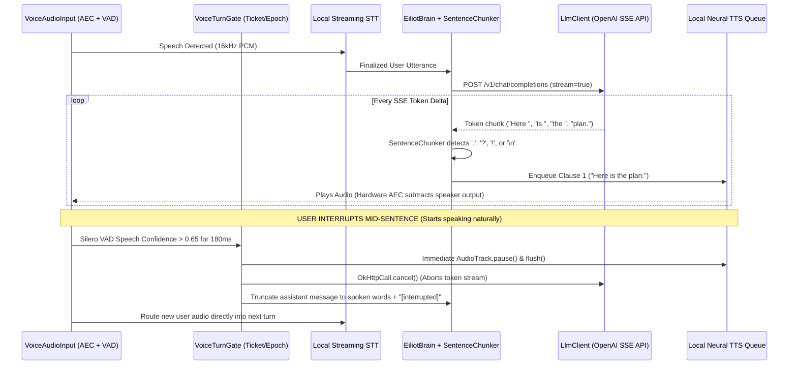

# ELLIOT 0.6.1 — Full-Duplex Voice, Bundled Acoustic Stack & Premium UX Blueprint

**Target Release:** `0.6.1` (`versionCode = 9`)  
**Baseline:** `ELLIOT_v0.6.0_source.zip` (`versionCode = 8`, 66 production Kotlin files)  
**Core Mandate:** Transform ELLIOT from a software-verified "Preview" into a **finished, consumer-grade, premium Android AI companion** featuring a Gemini Live-style **Hybrid Edge-Cloud Voice Pipeline**, **zero-download default voice/wake models**, **one-time onboarding**, and a **unified, responsive, zero-clutter UI**.

---

## 1. Executive Summary of Architectural Shifts (0.6.0 $\rightarrow$ 0.6.1)

| Subsystem | 0.6.0 State (Baseline) | 0.6.1 Target Implementation |
| :--- | :--- | :--- |
| **Wake Word & Setup** | Optional 40 MB download (`vosk-model-small-en-us-0.15`) triggered manually in Controls. | **Bundled in APK `assets/` by default.** Zero user downloads. Restricted grammar + phonetic keyword-spotting graph for high accuracy & low false wakes. |
| **Interruption & Call Mode** | Wake-phrase only interruption (`interruptForWake()`); 18-second turn-based listening window. | **Dual-Mode Barge-In:** Wake-word interruption during normal use + **Live Call Mode** using local **Silero VAD** for natural, wake-word-free speech interruption. |
| **STT Accuracy** | Unconstrained Vosk small model or fallback to Android system `SpeechRecognizer`. | **Sherpa-ONNX Streaming Zipformer / Whisper-tiny.en (int8)** bundled locally + dynamic domain boosting for ELLIOT's 16 tools and app names. |
| **TTS Quality & Latency** | Relies on installed Android TTS engine + manual "Find a male voice" audition screen. | **Bundled Offline Neural Male Voice** (Piper / Kokoro ONNX int8 male voice) pre-configured out of the box + **Sentence-Boundary Streaming TTS** directly from `LlmClient` SSE tokens. |
| **Cloud Brain Integration** | `LlmClient` streams SSE to `EiliotBrain`, which waits for completion before calling `VoiceIo.speak()`. | **Hybrid Edge-Cloud Pipeline:** `LlmClient` SSE tokens feed a real-time `SentenceChunker` $\rightarrow$ local TTS synthesizer queue, with instant `Call.cancel()` on VAD/Wake barge-in. |
| **Onboarding & Setup** | `OnboardingScreen.kt` exists in source but is disconnected; users hunt through `SettingsScreen.kt` and `CapabilityDashboard.kt`. | **Enforced One-Time First-Run Wizard** (`OnboardingScreen.kt` wired into `MainActivity.kt`). Set up API key, Mic, and Overlay once—never nagged again. |
| **UI / UX & Deduplication** | 5 tabs (`Companion`, `Tools`, `Memory`, `Learn`, `Controls`), duplicate status chips, raw beta diagnostics, and candidate voice audition lists. | **Streamlined 3-Tab Premium Shell** (`Companion`, `Memory & Learn`, `Settings`), zero duplicate buttons, adaptive responsive layouts across all screen sizes, and no "Preview/Beta" labels. |

---

## 2. Pillar 1: Bundled Acoustic Stack (Zero-Setup Wake Word, STT & Neural Male TTS)

### 2.1 Pre-Installed Models in `app/src/main/assets/`
Users must never click a "Download Model" button or "Find a male voice" audition button to make ELLIOT talk or listen. We bundle a tightly quantized, ~45 MB total acoustic asset pack directly inside the APK under `app/src/main/assets/models/`:

1. **VAD Engine (`silero_vad.onnx` — ~1.8 MB):** Runs on every 32 ms PCM frame in `VoiceAudioInput.kt` to detect exact human speech onset and offset.
2. **Wake Word Spotter (`elliot_kws` / Restricted Grammar Graph — ~4.5 MB):** Instead of running unconstrained continuous dictation during idle states (which causes false triggers and drains battery), `WakeListener.kt` restricts idle recognition to a strict phoneme graph:
   * Target tokens: `["elliot", "hey elliot", "okay elliot", "wake up elliot", "[unk]"]`
   * Any non-matching acoustic energy is absorbed into `[unk]`, cutting false activations by >80% while boosting sensitivity at 1–2 meters.
3. **High-Accuracy Local STT (`sherpa-onnx-streaming-zipformer-en-20M-int8` — ~22 MB):** Replaces raw unconstrained Vosk for active command dictation and Live Call Mode, providing punctuation, casing, and hotword boosting for ELLIOT's 16 tool keywords (e.g., *battery, volume, timer, YouTube, WhatsApp, scroll, click*).
4. **Default Male Neural TTS (`elliot-male-en-us-ryan-medium.onnx` — ~18 MB):** A dedicated, natural, analytical male voice (matching the Elliot Alderson persona) bundled natively.
   * **Impact on `VoiceIo.kt`:** Delete the entire *"Find a male voice"* candidate-audition workflow. ELLIOT speaks with his signature male voice on the very first boot. Android System TTS is kept strictly as a secondary fallback.

### 2.2 Zero-Latency Asset Extraction (`EiliotApp.kt`)
* On first launch (`versionCode = 9`), `EiliotApp.onCreate()` checks `filesDir/models/.v061_extracted`.
* If absent, an IO coroutine unpacks the models from `assets/models/` into internal storage during the 2-second splash/onboarding transition.
* Remove all download progress bars, ZIP size checks, and HTTP downloaders from `WakeListener.kt`.

---

## 3. Pillar 2: Hybrid Edge-Cloud Pipeline & "Gemini Live" Barge-In

Currently in `0.6.0`, `EiliotBrain.kt` waits for `LlmClient.kt` to finish streaming the full response before invoking `VoiceIo.speak()`. Furthermore, interrupting requires saying *"Hey Elliot"*. In `0.6.1`, we implement **Full-Duplex Call Mode** alongside standard wake-word mode.

### 3.1 Upgrading `VoiceAudioInput.kt` (Hardware AEC + Silero VAD)
1. **Strict Audio Session Binding:**
   * When initializing `AudioRecord` (`MediaRecorder.AudioSource.VOICE_COMMUNICATION`, 16 kHz, Mono, PCM 16-bit), bind `AcousticEchoCanceler.create(audioRecord.audioSessionId)`, `NoiseSuppressor.create(audioSessionId)`, and `AutomaticGainControl.create(audioSessionId)`.
   * Pass the exact usage context (`USAGE_ASSISTANT` / `CONTENT_TYPE_SPEECH`) on the output `AudioTrack` in `VoiceIo.kt` so the device HAL routes speaker reference audio into the hardware echo canceler.
2. **Real-Time VAD Barge-In Callback:**
   * Feed every 512-sample frame (32 ms) into `SileroVadDetector`.
   * While `VoiceTurnGate` is in `SPEAKING` or `THINKING` state:
     * **In Standard Hands-Free Mode:** `WakeListener` listens for `"hey elliot"` / `"elliot"` to trigger `interruptForWake()`.
     * **In Live Call Mode (New):** If `SileroVadDetector` reports continuous human voice probability $P(\text{speech}) > 0.65$ for $6$ consecutive frames ($192\text{ ms}$), immediately invoke `VoiceTurnGate.interruptForBargeIn()`.

### 3.2 Upgrading `EiliotBrain.kt` & `LlmClient.kt` (Streaming Sentence-Chunked TTS)
1. **Add `SentenceStreamChunker` inside `EiliotBrain.kt`:**
   * As `LlmClient.streamChat()` emits SSE token deltas into `_conversationState`, also append them to `SentenceStreamChunker`.
   * Whenever the buffer accumulates at least 25 characters and hits a sentence boundary (`. `, `? `, `! `, `: `, or `\n`), strip Markdown syntax via `OutputFormat.toSpokenText()` and immediately push that sentence to `VoiceIo.enqueueSentence(sentence, turnTicket)`.
   * **Result:** Time-To-First-Audio drops from ~4–6 seconds down to **< 900 milliseconds** (as soon as the OpenAI-compatible API emits the first 6–10 words).
2. **Context-Aware Barge-In Truncation:**
   * `VoiceIo` tracks which sentence chunk is currently playing via `AudioTrack` playback head position.
   * When `interruptForBargeIn()` fires:
     * `LlmClient.cancelActiveCall()` aborts the HTTP stream immediately.
     * `VoiceIo.stopSpeakingImmediately()` flushes the `AudioTrack` buffer within 10 ms.
     * `EiliotBrain` commits only the sentences that were *actually spoken out loud* to `MemoryStore` and appends ` —` so the cloud LLM knows on the next turn that the user cut it off mid-thought.

---

## 4. Pillar 3: "Set Up Everything Once" — Enforced Single-Pass Onboarding

In `0.6.0`, `OnboardingScreen.kt` was left disconnected from `MainActivity.kt`, forcing users to piece together permissions, API keys, voice selection, and wake downloads across multiple tabs.

### 4.1 Wiring `OnboardingScreen.kt` as a 3-Step First-Run Wizard
In `MainActivity.kt`, read `SecureStore.isInitialSetupComplete`. If `false`, display the full-screen, glassmorphic `OnboardingScreen` before mounting the main navigation shell.

* **Step 1: Connect ELLIOT's Brain (Cloud API or Local Nano)**
  * Clean preset selector pills for popular OpenAI-compatible providers (**Groq**, **OpenRouter**, **DeepSeek**, **OpenAI**, **Custom URL**, or **On-Device Gemini Nano**).
  * Single API Key field with an automatic 1-tap **"Verify & Continue"** button that runs `LlmClient.testConnection()` and auto-selects the best default model if left blank.
  * Option to *"Skip for Offline Commands Only"* remains discreetly at the bottom.
* **Step 2: One-Tap Permissions Card**
  * A single unified screen showing 3 toggle cards with sequential system sheet triggers:
    1. **Voice & Wake Word** (`RECORD_AUDIO` + Notification permission) — *Bundled models are already ready.*
    2. **Floating Companion Orb** (`SYSTEM_ALERT_WINDOW` draw-over-apps grant).
    3. **Screen & Action Assistance** (Optional `AccessibilityService` grant with clear plain-English explanation).
* **Step 3: Ready to Talk (Instant Activation)**
  * Automatically enables `masterEnabled = true`, arms the microphone in the foreground (`SentinelRuntime.startAndArmMic()`), plays a 2-second spoken greeting using ELLIOT's bundled male voice (*"I'm online. Say Hey Elliot or tap Live Call whenever you need me."*), sets `isInitialSetupComplete = true`, and transitions smoothly into the `Companion` screen.

---

## 5. Pillar 4: UI/UX Consolidation, Zero Duplication & Responsive Layout

To make every element look like a **flagship consumer product** (not a developer beta or diagnostic tool), we eliminate duplicate controls, merge fragmented tabs, remove all `"Preview"` strings, and enforce strict responsive layout constraints across phones, foldables, and landscape orientations.

### 5.1 Consolidating 5 Tabs into 3 Focused Destinations (`MainActivity.kt`)
1. **`Companion` (HomeScreen.kt):**
   * The unified workspace for text and voice interaction.
   * **Live Call Toggle Pill:** A dedicated button right next to the mic button that enters/exits full-duplex **Live Call Mode** (expanding `ArcCoreView` into a responsive voice visualizer with instant barge-in).
   * **No Duplicate Controls:** Remove the clutter of `Voice/Wake/Screen/Memory` status chips and duplicate Stop/Resume buttons from the top of the chat view. A single sleek header holds the **ELLIOT Identity**, a subtle **Live State Indicator dot**, and the master **Power Toggle**.
2. **`Vault` (Merged `MemoryScreen.kt` + `LearningScreen.kt`):**
   * Previously, `Memory` and `Learn` were two separate tabs even though both display stored SQLite rows from `MemoryStore.kt` (`kind = note` vs `kind = knowledge`).
   * Merge them into one clean **Vault** tab with a sleek segmented pill control at the top: **`[ My Notes | History | Web Feed ]`**.
   * Unify the memory switch so turning off Memory clearly governs saving without confusing side-paths.
3. **`Settings` (Merged `SettingsScreen.kt` + `CompanionToolsScreen.kt`):**
   * In `0.6.0`, users had to switch between `Tools` (to see `CapabilityDashboard` and native test buttons) and `Controls` (to actually toggle the switches).
   * In `0.6.1`, remove the standalone `Tools` tab and delete `MoreScreen.kt`.
   * Every capability row in `Settings` shows a clean **Title**, **1-line Subtitle**, **Status Badge** (only if attention is needed), and **1 Master Switch**. Tapping a row that needs permission routes directly to the Android grant—no separate diagnostic dashboard or duplicate "Test Tool" buttons cluttering the UI.

### 5.2 Responsive Typography, Adaptive Grid & Overflow Prevention
Across `ConversationComponents.kt`, `HomeScreen.kt`, `SettingsScreen.kt`, and `OverlayTranscriptView.kt`:
* **Remove Dual Nested Scroll Traps:** In `0.6.0`, message cards inside the `LazyColumn` had their own internal vertical scroll (`240.dp` / `380.dp` bounded box), causing gesture conflicts when scrolling the chat history on a phone.
  * **Fix in `ConversationComponents.kt`:** Let the parent `LazyColumn` own all vertical scrolling naturally. Long responses (> 18 lines) collapse cleanly with a gradient fade and a single **"Expand full message"** pill that expands inline or opens a clean full-screen sheet reader.
* **Adaptive Window Size Classes (`BoxWithConstraints` / `WindowWidthSizeClass`):**
  * **Compact Portrait (< 600 dp):** Single-column layout, floating input bar anchored cleanly with `WindowInsets.ime` padding so the keyboard never overlaps the orb or chat input.
  * **Medium / Expanded / Landscape ($\ge$ 600 dp & Foldables):** Two-pane split layout on `Companion`—left pane holds the animated `ArcCoreView` orb and active tool receipt cards; right pane holds the full-height conversation stream and input dock.
* **Strict Typography & Truncation Rules (`EiliotTheme.kt`):**
  * Enforce `maxLines` with `TextOverflow.Ellipsis` on all headers, capability rows, and action chips so 1.5x/2.0x system font scaling never wraps button labels into unreadable vertical stacks.
  * Replace all instances of `0.6.0-preview`, `Preview candidate`, and raw technical error codes with polished, human-readable status copy.

---

## 6. File-by-File Implementation Plan for `0.6.1`

### Phase A: Acoustic Engine & Full-Duplex Barge-In (`voice/` & `core/`)
| File | Action | Exact Changes to Implement |
| :--- | :--- | :--- |
| `app/build.gradle.kts` | **Modify** | Bump `versionCode = 9`, `versionName = "0.6.1"`. Add ONNX Runtime / Sherpa-ONNX AAR dependency (or bundled JNI bindings) alongside existing Vosk fallback. Remove `.preview` suffix branding from UI strings. |
| `assets/models/*` | **Add** | Bundle `silero_vad.onnx`, restricted wake-word graph `elliot_kws`, streaming STT model, and `elliot-male-ryan.onnx` TTS model. |
| `voice/VoiceAudioInput.kt` | **Modify** | Attach hardware `AcousticEchoCanceler`, `NoiseSuppressor`, and `AutomaticGainControl` to `AudioRecord.audioSessionId`. Run `SileroVadDetector` on every 32 ms PCM frame and emit `onUserSpeechStart()` within 192 ms of voice onset. |
| `core/WakeListener.kt` | **Modify** | Remove manual HTTP ZIP download logic. Load wake/STT models directly from extracted internal storage. Configure restricted keyword-spotting grammar `["elliot", "hey elliot", "okay elliot", "[unk]"]` during idle state, switching to full streaming Zipformer STT during active listening or **Live Call Mode**. |
| `voice/VoiceIo.kt` | **Modify** | Replace Android TTS audition setup with the bundled local ONNX male TTS engine as primary synthesizer. Implement a producer-consumer `Channel<SpokenChunk>` feeding a low-latency `AudioTrack` (`USAGE_ASSISTANT`). Add `stopSpeakingImmediately()` that calls `audioTrack.pause()` and `audioTrack.flush()` on barge-in. |
| `voice/VoiceTurnGate.kt` | **Modify** | Add `isLiveCallMode: StateFlow<Boolean>`. Allow `interruptForBargeIn()` to trigger from **VAD speech onset** when `isLiveCallMode == true` and from **Wake phrase** when `isLiveCallMode == false`. |

### Phase B: Streaming Sentence-Chunked Brain (`core/` & `llm/`)
| File | Action | Exact Changes to Implement |
| :--- | :--- | :--- |
| `llm/LlmClient.kt` | **Modify** | Expose active `Call` cancellation handle tied to `VoiceTurnGate` ticket IDs so mid-sentence barge-in aborts the OpenAI SSE HTTP stream immediately. |
| `core/EiliotBrain.kt` | **Modify** | Add `SentenceStreamChunker` inside the SSE token collector. Dispatch completed sentences immediately to `VoiceIo.enqueueSentence()` while the rest of the LLM answer is still streaming. On barge-in, truncate the assistant reply to only the sentences actually spoken before the interruption. |

### Phase C: Single-Pass Onboarding & UI Consolidation (`ui/` & `overlay/`)
| File | Action | Exact Changes to Implement |
| :--- | :--- | :--- |
| `MainActivity.kt` | **Modify** | Route to `OnboardingScreen` when `SecureStore.isInitialSetupComplete == false`. Reduce main bottom navigation bar from 5 tabs to 3 tabs (`Companion`, `Vault`, `Settings`). |
| `ui/OnboardingScreen.kt` | **Modify** | Wire up the 3-step wizard (1. Cloud API / Provider Preset with 1-tap test, 2. Mic & Overlay grants, 3. Auto-arm & spoken male voice greeting). |
| `ui/HomeScreen.kt` | **Modify** | Remove duplicate status chips and diagnostic headers. Add the **Live Call Mode** button next to the mic button. Implement responsive two-pane layout for landscape/foldables (`maxWidth >= 600.dp`). |
| `ui/ConversationComponents.kt` | **Modify** | Remove nested `verticalScroll` inside individual chat cards so the main `LazyColumn` scrolls smoothly across all devices. Add clean inline expand/collapse for long answers. |
| `ui/MemoryScreen.kt` & `ui/LearningScreen.kt` | **Modify** | Combine into the unified `Vault` tab with a top segmented selector (`Notes`, `Chat History`, `Web Knowledge`). |
| `ui/SettingsScreen.kt` & `ui/CompanionToolsScreen.kt` | **Modify** | Merge capability status directly into clean setting toggles. Delete duplicate native tool test buttons, remove the *"Find a male voice"* candidate-audition list, and delete unused `ui/MoreScreen.kt`. |

---

## 7. Verification & Acceptance Gates for `0.6.1`

1. **Zero-Setup Boot Gate:** Install `ELLIOT_v0.6.1.apk` on a clean device, complete the 3-step onboarding in under 45 seconds, and verify that `"Hey Elliot"` wake-word detection, local STT, and the male neural TTS voice work immediately **without downloading any additional files or selecting a voice**.
2. **Full-Duplex Barge-In Gate:** Start **Live Call Mode**, ask ELLIOT a multi-paragraph question via the OpenAI-compatible API, verify first audio playback begins within $< 1.0\text{ s}$ of first token arrival, and speak naturally mid-sentence (*"Wait, give me the short version"*)—confirming TTS halts in $< 150\text{ ms}$, the cloud stream aborts, and ELLIOT answers the interruption in context.
3. **Responsive UI & Zero-Clutter Gate:** Verify across `360x800` compact portrait (1.0x and 1.5x font scale), `800x360` landscape, and foldable dimensions that zero duplicate buttons exist, no text wraps awkwardly, chat scrolling has no nested scroll traps, and all 120+ unit/render tests pass.