<p align="center">
  
</p>

<p align="center">
  
  
  
  
</p>

<p align="center">
  <a href="#quick-start"><b>Quick start</b></a> &nbsp;✦&nbsp;
  <a href="#meet-the-app"><b>Meet the app</b></a> &nbsp;✦&nbsp;
  <a href="#the-holo-core"><b>The Holo Core</b></a> &nbsp;✦&nbsp;
  <a href="#speech-modes"><b>Speech modes</b></a> &nbsp;✦&nbsp;
  <a href="#how-voice-works"><b>How voice works</b></a> &nbsp;✦&nbsp;
  <a href="#development-snapshot"><b>Project status</b></a> &nbsp;✦&nbsp;
  <a href="#build-from-source"><b>Build</b></a>
</p>

<p align="center"></p>

ELLIOT is a voice and text companion for Android. Say the wake phrase, tap the microphone, or type. Built-in commands can check your battery, set a timer, and change media volume offline. Wake detection, bundled speech recognition, and bundled voice playback run on the phone. For broader conversations, you can select a supported on-device or cloud provider in Settings.

<table>
  <tr>
    <td width="25%" valign="top"><b>🎙️ Talk</b><br />Wake, tap, or type.</td>
    <td width="25%" valign="top"><b>🧠 Speech</b><br />Bundled STT or optional Whisper.</td>
    <td width="25%" valign="top"><b>🔮 See</b><br />A 3D hologram that shows what ELLIOT is doing.</td>
    <td width="25%" valign="top"><b>⚙️ Control</b><br />Tune capture, filters, and providers.</td>
  </tr>
</table>

## Quick start

> [!TIP]
> In-place updates require the same package ID and signing certificate. The preview uses the package ID `com.eiliot.app.preview`.

1. [Build the ARM64 preview from source](#build-from-source) and install your build on an **ARM64 Android 8.0+** device.
2. Open **ELLIOT**, tap **Resume**, grant microphone access, and enable **Voice & wake word** in Settings.
3. Say **“Hey Elliot”**, pause, and ask **“What is my battery level?”** You can also tap the microphone to start a request.
4. For an optional speech model, open **Settings → Check speech recognition**, select a pack and language, and choose **Use for live requests** once the pack is ready.

## Meet the app

The interface is called **Singularity**. ELLIOT lives as a hologram in a deep-space observatory, with smoked glass over a moving starfield. Light comes from the orb.

<table>
  <thead>
    <tr>
      <th width="25%">01 &nbsp; Companion</th>
      <th width="25%">02 &nbsp; Vault</th>
      <th width="25%">03 &nbsp; Settings</th>
      <th width="25%">04 &nbsp; Floating orb</th>
    </tr>
  </thead>
  <tbody>
    <tr>
      <td align="center">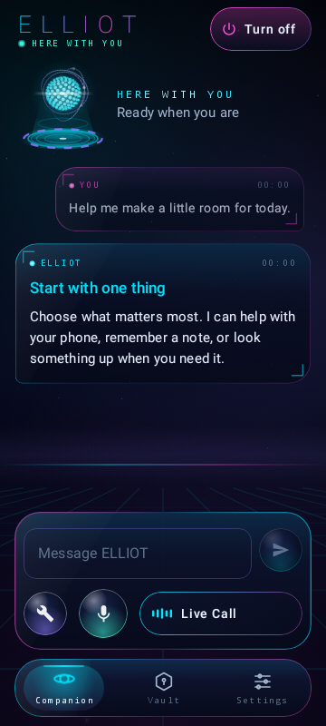</td>
      <td align="center">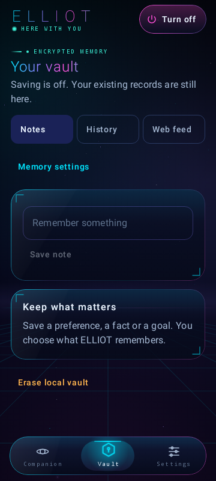</td>
      <td align="center">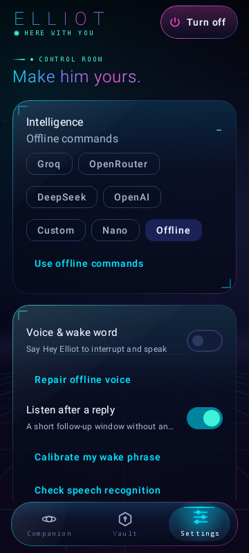</td>
      <td align="center">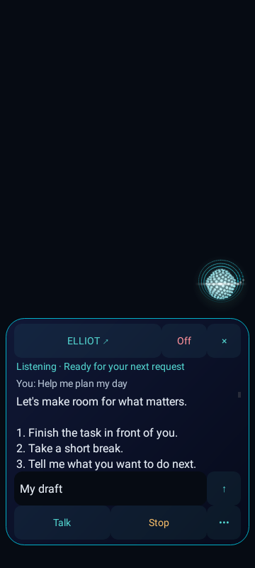</td>
    </tr>
    <tr>
      <td align="center"><b>Your conversation</b><br />Talk, type, or open Live Call.</td>
      <td align="center"><b>Your saved context</b><br />Manage notes, history, and references.</td>
      <td align="center"><b>Your preferences</b><br />Choose voice, provider, and privacy controls.</td>
      <td align="center"><b>Over other apps</b><br />Captions and controls beside the orb.</td>
    </tr>
  </tbody>
</table>

<details>
<summary><b>See the wide layout for tablets and foldables</b></summary>
<br />
<p align="center">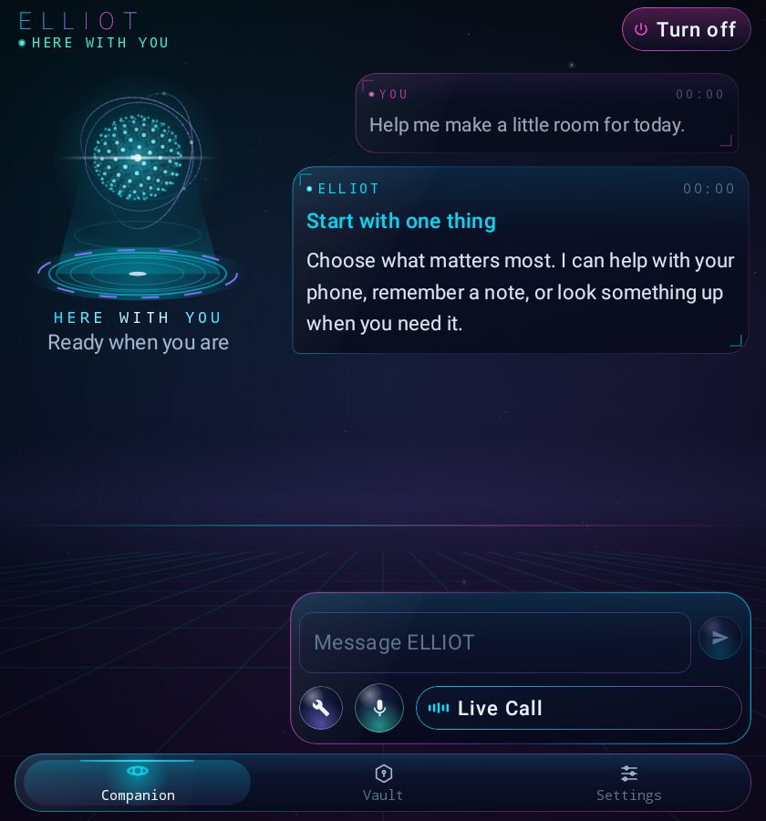</p>
</details>

*Jetpack Compose renders from the Robolectric shell tests with sample data. They are still frames, so the motion described below is not visible in them.*

| Feature | What you can do |
| --- | --- |
| **Personal wake phrase** | Calibrate “Hey Elliot” using your pronunciation. Fresh examples and control phrases must pass before a profile can be saved. |
| **Voice in a noisy room** | Compare the same wake recording with and without enhanced noise reduction. Eligible full-phrase profiles can listen before that filter while commands still use it. |
| **Offline phone commands** | Ask for battery status, set a timer, adjust volume, or open an app. Actions depend on the permissions you grant. |
| **Optional multilingual speech** | Download Whisper Small or Large-v3 Turbo. Choose Indian English, Hindi-English, Bengali-English, or Auto for short requests. |
| **Your choice of conversation mode** | Use offline commands, on-device Nano on supported phones, or a configured cloud provider for broader conversation. |
| **A living interface** | A 3D orb you can spin, a conversation with depth, and a starfield that shifts as you tilt the phone. |

## The Holo Core

<p align="center">
  
</p>

The orb is a real-time 3D particle hologram: 240 glowing particles, three gyroscope rings with beads riding them, a plasma core, and a lens streak. Particles closer to the camera are larger and brighter, so the depth is real. Each state has its own 3D form. When ELLIOT changes state, every particle flies to its place in the next form.

The orb above is generated from the same forms the app uses, so the README and the phone show the same hologram.

<table>
  <tr>
    <td width="33%" valign="top"><b>✦ Spin it</b><br />Inside the app, drag the orb to turn it. It keeps turning after you let go.</td>
    <td width="33%" valign="top"><b>✦ Tilt it</b><br />The orb, its projector, and the starfield shift as you tilt the phone.</td>
    <td width="33%" valign="top"><b>✦ Everywhere</b><br />The same hologram floats over other apps, where you can drag it to a new spot.</td>
  </tr>
  <tr>
    <td valign="top"><b>✦ Conversation depth</b><br />Messages lean back into space as they scroll up and flip in as they arrive.</td>
    <td valign="top"><b>✦ Command deck</b><br />An aurora edge, a voice sphere with sonar rings, and a Live Call equaliser.</td>
    <td valign="top"><b>✦ Calm when asked</b><br />With Android animations off, or Motion set to Reduced, everything holds still.</td>
  </tr>
</table>

<details>
<summary><b>How the hologram is built</b></summary>
<br />

| Piece | Where |
| --- | --- |
| 3D forms, perspective projection, morphing, and drawing | [HoloCoreRenderer.kt](app/src/main/java/com/eiliot/app/overlay/HoloCoreRenderer.kt) |
| Orb view: states, touch spin with inertia, tilt, frame loop | [ArcCoreView.kt](app/src/main/java/com/eiliot/app/overlay/ArcCoreView.kt) |
| Shared clock, tilt parallax, starfield, projector stage, conversation depth | [Holo.kt](app/src/main/java/com/eiliot/app/ui/Holo.kt) |
| README artwork generator (animated SVG) | [generate_art.py](docs/brand/generate_art.py) |

The orb uses plain Canvas drawing, so it looks the same on Android 8 and Android 16 without shaders. The floating orb runs at about 30 fps and stops when idle. The tilt sensor is registered only while the app is open.

</details>

## Speech modes

<p align="center">
  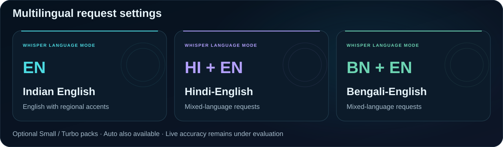
</p>

Choose a language setting and an optional **Whisper Small** or **Large-v3 Turbo** pack for short requests. The same model family handles these settings. Wake calibration adapts phrase matching separately. Hindi-English and Bengali-English still need more real-speech accuracy testing.

<details>
<summary><b>Compare the speech engine options</b></summary>
<br />

| Engine | Role in the app | Current evidence |
| --- | --- | --- |
| **Bundled Zipformer** | Default streaming English STT and Live Call | Runs offline. Misheard the live battery question in an earlier Vivo test. |
| **Whisper Small** | Optional multilingual short requests | Downloadable pack. Bengali-English results have included word errors and incomplete output. |
| **Whisper Large-v3 Turbo int8** | Optional multilingual short requests | Recognized the live Indian English battery question. Load and transcription took about 10 seconds in that run. |
| **Turbo · unquantized decoder** | Optional variant of Turbo for short requests | Same encoder with the full decoder (about 636 MB). Not yet measured on a device; expect more memory and longer decoding than Turbo int8. |

</details>

## How voice works

<p align="center">
  
</p>

The wake detector runs while the microphone listener is active. For eligible calibrated profiles, the wake path can use input before GTCRN while request audio still goes through it. A private `:speech` process isolates Sherpa-onnx native inference from the app UI. Cloud conversation is optional and can send recognized text and relevant context to the selected provider.

<details>
<summary><b>Explore the request-routing diagram</b></summary>
<br />

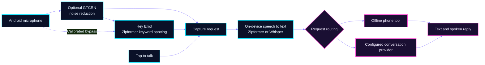

</details>

<p align="center"></p>

## Development snapshot

The current source is **0.6.3-dev.24**. These observations come from the Vivo checks recorded in the [agent handoff](AGENTS.md).

| | Check | Observed result |
| :---: | --- | --- |
| 🟢 | **Wake from a seat beside the table** | With the phone upright and the calibrated wake path listening before GTCRN, “Hey Elliot” opened listening and “Hey Ellie” was ignored in the live check. |
| 🟢 | **Live Indian English request** | Whisper Turbo recognized the battery question and the local phone-status command returned the answer. Model load and transcription took about **10 seconds** in that run. |
| 🟢 | **Singularity interface** | 181 unit tests pass, including the shell and overlay renders at 1x, 1.5x, and 2x text, landscape, and wide layouts. The ARM64 preview builds with release lint. |
| 🟠 | **Still under evaluation** | The flat-table recording missed. Performance across rooms, distances, and speakers remains unmeasured. Hindi-English and Bengali-English modes are selectable and need further live accuracy testing. The new interface still needs on-device checks of frame rate and battery use. |

### Next validation targets

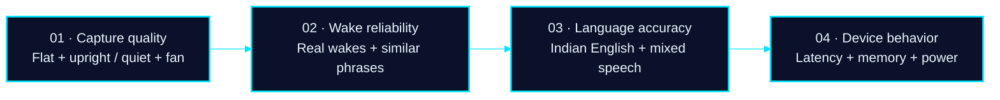

See the [voice evaluation guide](evaluation/voice/README.md) for the test procedure and [speech recovery notes](SPEECH_FIX.md) for the earlier native-worker crash fix.

## Build from source

Use **JDK 21**, **Android SDK 36**, and **Build Tools 35.0.0**. Set your SDK location in an untracked `local.properties` file or through your Android SDK environment.

```bash
git clone https://github.com/modhack2003/ELLIOT_ANDROID.git
cd ELLIOT_ANDROID
./gradlew :app:assemblePreview -PvoiceArm64Only=true
./gradlew :app:testPreviewUnitTest
```

On Windows PowerShell, use `.\gradlew.bat` in place of `./gradlew`. The ARM64 APK is built under `app/build/outputs/apk/preview/`. A locally signed preview uses your own debug signing key. The unit tests also write UI renders to `app/build/ui-review/`.

<details>
<summary><b>Run native checks on a dedicated Android test device</b></summary>
<br />

```bash
./gradlew :app:connectedPreviewAndroidTest -PvoiceArm64Only=true
```

Instrumentation runs the packaged speech engines and stops the companion service during setup. See the [voice evaluation guide](evaluation/voice/README.md) for optional model-pack tests and interpretation of results.

</details>

## Project resources

| Resource | Where to look |
| --- | --- |
| Current issues and next steps | [Agent handoff](AGENTS.md) |
| Architecture and implementation | [System design](EILIOT_SYSTEM_DESIGN.md) · [Android source](app/src/main/java/com/eiliot/app) |
| Speech models and versions | [Model sources](MODEL_SOURCES.json) · [Voice evaluation](evaluation/voice/README.md) |
| README artwork | [Brand notes](docs/brand/README.md) · [Generator](docs/brand/generate_art.py) |
| Terms and attribution | [Third-party models and runtime](THIRD_PARTY_MODELS.md) |

> [!NOTE]
> The speech runtime, voices, and model weights carry their upstream terms. The Ryan voice model card lists noncommercial dataset terms. See the third-party notices before redistributing an app or model pack.

<p align="center"></p>
