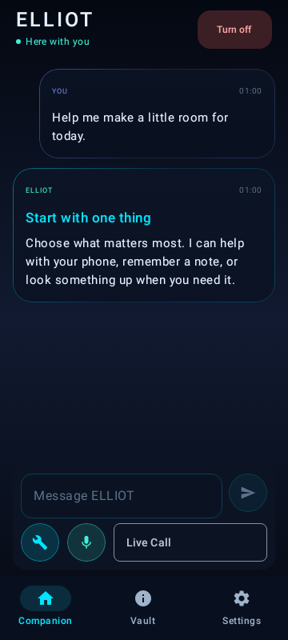
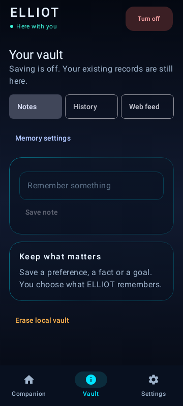
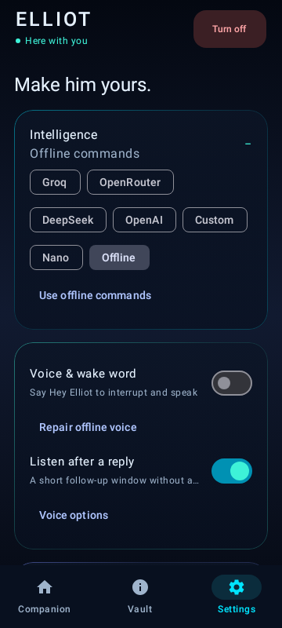
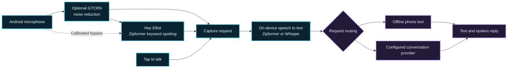

<p align="center">
  
</p>

<h1 align="center">ELLIOT for Android</h1>

<p align="center">
  <strong>Say “Hey Elliot”. Ask about your phone. Hear the answer.</strong>
</p>

<p align="center">
  
  
  
  
</p>

<p align="center">
  <a href="#quick-start">Quick start</a> &nbsp;·&nbsp;
  <a href="#meet-the-app">Meet the app</a> &nbsp;·&nbsp;
  <a href="#how-voice-works">How voice works</a> &nbsp;·&nbsp;
  <a href="#build-from-source">Build from source</a>
</p>

ELLIOT is a voice and text companion for Android. Say the wake phrase, tap the microphone, or type. Built-in commands can check your battery, set a timer, and change media volume offline. Wake detection, bundled speech recognition, and bundled voice playback run on the phone. For broader conversations, you can select a supported on-device or cloud provider in Settings.

## Quick start

1. [Build the ARM64 preview from source](#build-from-source) and install your build on an **ARM64 Android 8.0+** device. In-place updates require the same package ID and signing certificate.
2. Open **ELLIOT**, tap **Resume**, grant microphone access, and enable **Voice & wake word** in Settings.
3. Say **“Hey Elliot”**, pause, and ask **“What is my battery level?”** You can also tap the microphone to start a request.
4. For an optional speech model, open **Settings → Check speech recognition**, select a pack and language, and choose **Use for live requests** once the pack is ready.

The preview uses the package ID `com.eiliot.app.preview`.

## Meet the app

<table>
  <thead>
    <tr>
      <th width="33%">Companion</th>
      <th width="33%">Vault</th>
      <th width="33%">Settings</th>
    </tr>
  </thead>
  <tbody>
    <tr>
      <td align="center"></td>
      <td align="center"></td>
      <td align="center"></td>
    </tr>
    <tr>
      <td>Talk, type, or open Live Call.</td>
      <td>Manage notes, history, and saved references.</td>
      <td>Choose voice, provider, and privacy controls.</td>
    </tr>
  </tbody>
</table>

<sub>Actual Jetpack Compose renders from 0.6.2 with sample data. Current voice options have since expanded.</sub>

| Feature | What you can do |
| --- | --- |
| **Personal wake phrase** | Calibrate “Hey Elliot” using your pronunciation. Fresh examples and control phrases must pass before a profile can be saved. |
| **Voice in a noisy room** | Compare the same wake recording with and without enhanced noise reduction. Eligible full-phrase profiles can listen before that filter while commands still use it. |
| **Offline phone commands** | Ask for battery status, set a timer, adjust volume, or open an app. Actions depend on the permissions you grant. |
| **Optional multilingual speech** | Download Whisper Small or Large-v3 Turbo. Choose Indian English, Hindi-English, Bengali-English, or Auto for short requests. |
| **Your choice of conversation mode** | Use offline commands, on-device Nano on supported phones, or a configured cloud provider for broader conversation. |

## How voice works



The wake detector runs while the microphone listener is active. For eligible calibrated profiles, the wake path can use input before GTCRN while request audio still goes through it. A private `:speech` process isolates Sherpa-onnx native inference from the app UI. Cloud conversation is optional and can send recognized text and relevant context to the selected provider.

### What the Vivo test verified

| Check | Observed result |
| --- | --- |
| **Wake from a seat beside the table** | With the phone upright and the calibrated wake path listening before GTCRN, “Hey Elliot” opened listening and “Hey Ellie” was ignored in the live check. |
| **Live Indian English request** | Whisper Turbo recognized the battery question and the local phone-status command returned the answer. Model load and transcription took about **10 seconds** in that run. |
| **Still under evaluation** | The flat-table recording missed. Performance across rooms, distances, and speakers remains unmeasured. Hindi-English and Bengali-English modes are selectable and need further live accuracy testing. |

See the [voice evaluation guide](evaluation/voice/README.md) for the test procedure and [speech recovery notes](SPEECH_FIX.md) for the earlier native-worker crash fix.

## Build from source

Use **JDK 21**, **Android SDK 36**, and **Build Tools 35.0.0**. Set your SDK location in an untracked `local.properties` file or through your Android SDK environment.

```bash
git clone https://github.com/modhack2003/ELLIOT_ANDROID.git
cd ELLIOT_ANDROID
./gradlew :app:assemblePreview -PvoiceArm64Only=true
./gradlew :app:testPreviewUnitTest
```

On Windows PowerShell, use `.\gradlew.bat` in place of `./gradlew`. The ARM64 APK is built under `app/build/outputs/apk/preview/`. A locally signed preview uses your own debug signing key.

<details>
<summary><strong>Run native checks on a dedicated Android test device</strong></summary>

```bash
./gradlew :app:connectedPreviewAndroidTest -PvoiceArm64Only=true
```

Instrumentation runs the packaged speech engines and stops the companion service during setup. See the [voice evaluation guide](evaluation/voice/README.md) for optional model-pack tests and interpretation of results.

</details>

## Project resources

| Resource | Where to look |
| --- | --- |
| Architecture and implementation | [System design](EILIOT_SYSTEM_DESIGN.md) · [Android source](app/src/main/java/com/eiliot/app) |
| Speech models and versions | [Model sources](MODEL_SOURCES.json) · [Voice evaluation](evaluation/voice/README.md) |
| Terms and attribution | [Third-party models and runtime](THIRD_PARTY_MODELS.md) |

The speech runtime, voices, and model weights carry their upstream terms. The Ryan voice model card lists noncommercial dataset terms. See the third-party notices before redistributing an app or model pack.
