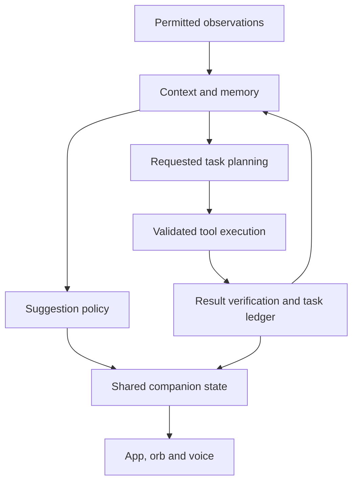

# ELLIOT — Future Companion, Functionality, UX and Design Roadmap

**Prepared:** 29 October 2026, India time  
**Baseline:** ELLIOT 0.3.1, version code 5  
**Revision:** HF-2 — mandatory next-build spoken check-ins and wake-word interruption, retaining HF-1 hands-free authorization requirements; 29 October 2026  
**Document status:** Proposal and discussion roadmap. These additions have not been implemented by creating this document.  
**Product direction:** Add capabilities, preserve useful existing features, and make ELLIOT feel present, capable and easy to live with.

> ELLIOT should become a companion who can understand permitted context, remember what matters, suggest useful next steps and complete real tasks—with clear controls over what he observes and does.

**Owner requirement added in HF-1:** A clear instruction from the owner is authorization for the matching supported task. ELLIOT must not ask for a second in-app Allow tap just to execute that instruction. Conversation, clarification, eligible confirmations, event announcements and cancellation should work by voice from about 1–2 metres away. See section 8.2. This supersedes the earlier proposal to keep per-action app approvals as the default; it does not change the already-delivered 0.3.1 APK.

### Mandatory for the next build — HF-2

| Release requirement | Must deliver |
| --- | --- |
| Automatic spoken check-ins | ELLIOT starts a conversation within the owner's selected time frames: for example, “What are you doing?”, “How are you?” or a relevant project question. This must not depend on the owner speaking first or a notification arriving. |
| Wake-word interruption while speaking | Saying **“Elliot” or “hey Elliot”** during ELLIOT's speech stops that speech and immediately starts listening to the owner's new request. No manual Stop tap and no second wake-word repetition. |
| Complete hands-free flow | ELLIOT initiates → owner answers → ELLIOT responds → owner interrupts with the wake word → ELLIOT stops and listens → the new request continues without a tap. |

**Both features are mandatory next-build release gates, not optional backlog work.** Quiet, snooze and global Off remain owner controls. These requirements describe future implementation; editing this file does not update the APK.

## 1. What we should aim for

The biggest advance is the connection between **awareness, memory, initiative and execution**. More animation alone will not create that experience.

The target experience is:

1. ELLIOT notices an event from a source the owner enabled.
2. He connects it with relevant memories, current goals and unfinished work.
3. He decides whether to stay quiet, display a suggestion or speak.
4. He explains what he noticed without pretending to know more than the evidence supports.
5. A clear owner request authorizes the matching supported steps; an already-configured routine authorizes its defined scope. ELLIOT executes and checks the result without a redundant app approval page.
6. He remembers the outcome, accepts corrections and stops when asked.

Examples of **future**, optional behavior:

| Situation | Intended companion behavior | Required foundation |
| --- | --- | --- |
| A chosen entertainment app has been used longer than the owner's chosen limit | “You've passed the break time you set. Want to pause?” | Usage Access, an owner-defined rule, interruption controls |
| The owner returns to an unfinished project | “We stopped after comparing these two options. Continue?” | Project memory and an explicit or permitted context signal |
| New material appears on a followed topic | Prepare a short sourced brief and offer it at a suitable time | Topic subscriptions, scheduled retrieval, source checking |
| A task fails because an app changed its screen | Explain the mismatch, preserve progress and request a fresh observation | Task checkpoints, screen freshness and result verification |
| The owner says “not now” | Dismiss the suggestion, apply the chosen snooze and avoid repeating it | Feedback memory and notification cooldowns |
| Internet access disappears | Explain which local capabilities remain and retain unfinished work | Capability discovery and task persistence |
| The owner says “ELLIOT, set media volume to 30 percent” | Execute the supported change and speak the result without an Allow tap | Recognized command, existing grants and command-scoped authorization |
| A selected notification arrives while the owner is 1–2 metres away | Speak an eligible announcement or ask whether to read it; accept a spoken answer | Optional room mode, notification rules and a live voice dialogue |

These are design goals, not claims about the delivered APK.

## 2. Preserve the current app: the “add more, cut less” contract

### 2.1 Existing capabilities to retain

| Existing area | Keep | Expand rather than replace |
| --- | --- | --- |
| Text conversation | Streaming replies, session context, persistent draft, latest-message following | Search, branches, richer output, better history navigation |
| Orb and floating text | Movable orb, compact captions, expanded transcript, in-app visibility option | Better gestures, docking, contextual cards, clear state feedback |
| Voice | Tap-to-talk, partial transcript, selectable male voices, speech controls | Better turn-taking, bilingual input, repair of recognition errors |
| Wake activation | Optional local wake recognition | Better calibration, reliability diagnostics and additional activation methods |
| Memory | Local encrypted message/note bodies, memory toggle, erase control | Semantic retrieval, projects, correction, export and restore |
| Phone and web tools | All 16 existing tools | More integrations, better results, durable task execution |
| Screen assistance | Requested reads, freshness checks and supported node actions | Command-authorized assistance, clearer previews, guided sessions and OCR for owner-selected material |
| Proactivity | Optional check-ins and allowed-notification announcements | Event-driven suggestions with owner-selected frequency and scope |
| Learning | Existing reference-feed ingestion | User-selected topics, saved research, source changes and useful digests |
| On-device inference | Existing Gemini Nano path | Capability-aware upgrades and additional optional local engines |
| Global control | Turn Off, stop response, permission switches | Faster feedback, task cancellation visibility and stronger lifecycle coverage |

**Retain these tool names and their working equivalents:** `device_info`, `list_apps`, `open_app`, `open_settings`, `set_media_volume`, `set_timer`, `search_web`, `read_web_page`, `open_url`, `read_screen`, `click_screen`, `type_text`, `scroll_screen`, `navigate`, `save_memory`, `recall_memory`.

### 2.2 Rules for additions

- Introduce new capabilities as optional modules; upgrading must not silently turn on observation, proactivity or cloud sharing.
- Keep direct manual controls available even when an AI provider is unavailable.
- Preserve text as an alternative to every voice-first flow.
- Treat a clear owner command as authorization for its matching supported task. Do not insert a second Allow tap for that same request; retain optional manual review for owners who choose it.
- Prefer spoken clarification or confirmation when it is actually necessary, so the owner does not need to approach the phone for an ELLIOT-owned dialog.
- Keep a quiet mode. A more capable companion should also be better at staying quiet.
- Preserve male-only assistant voice selection; do not substitute an unconfirmed voice when a model disappears.
- Preserve the internal package/storage identifiers needed for existing data and update compatibility.
- Migrate data and settings explicitly; never require uninstalling to make an upgrade work.
- Keep the existing public web reader while adding optional authenticated service connectors separately.
- Put advanced controls behind progressive disclosure, rather than deleting them to simplify the interface.
- Keep current stable paths until replacements pass migration, accessibility and device acceptance checks.

### 2.3 Actual baseline gaps

Current proactivity is a simple idle check-in plus selected notification announcements. It does not continuously understand app activity. Memory retrieval is bounded and primarily lexical. Current tool execution has limited rounds and no durable task ledger. Rich text, account integrations and portable memory restoration are incomplete or absent. Screen/voice/orb/Nano behavior still needs physical-device acceptance testing despite the 50 passing tests recorded for 0.3.1.

The delivered 0.3.1 build also still uses per-action app approvals for many phone changes and screen operations. Removing that repeated tap requirement and adding conversational authorization are future work specified here, not capabilities added to the APK by this document revision.

## 3. How to read the roadmap

**Priority:** P0 = reliability or migration foundation; P1 = strongest companion/experience improvement; P2 = useful expansion; P3 = experimental integration.

**Delivery class:**

- **App:** Mainly our application architecture and UI.
- **Permission:** Needs a clear Android grant or owner-selected data source.
- **Integration:** Depends on another application, account API or service.
- **Conditional:** Hardware, model, language, Android version or manufacturer dependent.
- **Research:** Requires a feasibility prototype before any delivery promise.

Complexity ratings are relative: S = focused change, M = several components, L = substantial subsystem. They are not time estimates. “App” does not mean zero engineering or testing risk.

## 4. Highest-value additions

| ID | Addition | Why it matters | Priority | Delivery / complexity |
| --- | --- | --- | --- | --- |
| A01 | Live capability dashboard | Stops ELLIOT guessing what tools or permissions he has | P0 | App / M |
| A02 | Unified app, orb, voice and task state | Every surface agrees about what is happening | P0 | App / L |
| A03 | Durable task ledger and checkpoints | Long tasks can survive interruptions without blind repetition | P0 | App / L |
| A04 | Context and observation engine | Foundation for understanding permitted activity | P1 | Permission / L |
| A05 | Intelligent interruption policy | Proactivity becomes useful rather than repetitive | P1 | App / L |
| A06 | Project and episodic memory | ELLIOT can resume shared work with relevant context | P1 | App / L |
| A07 | Editable semantic memory | Better recall with visible evidence and corrections | P1 | App; optional model / L |
| A08 | Expressive, compact orb | Makes the companion feel responsive without covering the phone | P1 | App; overlay grant / M |
| A09 | Full conversation and voice-turn redesign | Less waiting, fewer accidental interruptions, clearer feedback | P1 | Conditional / L |
| A10 | Structured answers and action cards | Results become readable and usable | P1 | App / M |
| A11 | Personal routines and reminders | Converts useful suggestions into repeatable assistance | P1 | Permission / L |
| A12 | Encrypted export, restore and migration | Protects the owner's investment in memory and projects | P0 | App / L |
| A13 | Document and file workspace | Adds real everyday usefulness beyond chat | P2 | Permission / L |
| A14 | Calendar, contacts and service connectors | Enables tasks through supported, typed integrations | P2 | Integration / L |
| A15 | Personalized research and learning | Turns background retrieval into useful knowledge | P2 | App; network / L |
| A16 | Local/cloud model routing | Uses the right available engine without hidden data transfer | P2 | Conditional / L |
| A17 | Connected desktop and watch companion | Extends continuity across devices | P3 | Integration / L |
| A18 | Default-assistant and AppFunctions experiments | Explores deeper platform integration where available | P3 | Research / L |
| A19 | Command-scoped authorization without repeated Allow taps | Makes an explicitly requested task genuinely hands-free | P1 | App / L |
| A20 | Room mode with spoken event dialogue | Lets the owner interact from about 1–2 metres away without returning to the phone | P1 | Conditional / L |
| A21 | Automatic scheduled spoken check-ins | ELLIOT approaches the owner and starts a conversation within configured time frames | P0 — next-build gate | App; background voice validation / M |
| A22 | Wake-word interruption during speech | “Elliot” or “hey Elliot” immediately switches the speaking assistant to listening | P0 — next-build gate | Voice coordination; device validation / L |

## 5. Awareness and genuinely useful proactivity

### 5.1 Observation sources should be independent switches

| ID | Proposed source | What it enables | Scope and implementation direction |
| --- | --- | --- | --- |
| C01 | App-usage summaries | Break suggestions, focus sessions, daily usage review | Query supported usage statistics/events after the owner grants Usage Access; keep a timestamped, limited history [S1] |
| C02 | Device state | Charging, low battery, connectivity and available-resource suggestions | Prefer system callbacks and coarse snapshots over polling loops |
| C03 | Selected notifications | Group related updates and offer a digest | Per-app/category controls; local filtering before any optional model use |
| C04 | Owner-approved screen session | Contextual help while doing a particular task | Clearly bounded session, eligible apps and visible pause control; do not make screen observation a default |
| C05 | Calendar and reminders | Upcoming-event context and preparation suggestions | Separate integration and scoped access; owner chooses calendars |
| C06 | Explicit workspaces and goals | Understand “I'm working on the banquet plan” | Owner-defined project association is more reliable than guessing from an app name |
| C07 | Optional location or activity signals | Arrival routines or a quieter travel mode | Add only when the owner selects a feature needing them; test permission and power costs |
| C08 | Shared material | Understand a link, image, PDF or text sent to ELLIOT | Android share sheet or file picker; no broad collection requirement |

Usage history can support app-level observations; it does not reveal every action or the meaning of content inside another app. Multi-window use, delayed events and manufacturer differences require uncertainty handling. Do not equate “this app was active” with “the owner was definitely doing this exact thing.” [S1]

### 5.2 Context engine

Create an ephemeral context snapshot containing:

- Current user-selected project or goal.
- Recent permitted observations, source and observation time.
- Active conversation/task state.
- Related memories with provenance.
- Availability of tools, permissions, network and models.
- Interruption preferences, quiet hours and recent dismissals.
- Expiry and confidence for inferred context.

Separate **observed facts**, **owner statements** and **inferences**. For example: an app-usage event is an observation; “you seem distracted” is an inference and should not be treated as a fact.

### 5.3 A policy decides whether to interrupt

The pipeline should be: permitted event → local filter → context update → usefulness check → timing/channel decision → optional suggestion.

Before speaking, check whether the suggestion is relevant, recent, non-repetitive, within the owner's frequency budget and suitable for the current audio/device state. Most low-value events should produce no interruption.

| ID | Improvement | Intended behavior |
| --- | --- | --- |
| P01 | Contextual suggestions | Suggest something connected to a real observation or saved goal |
| P02 | Configurable initiative | Quiet, Suggestions only, Companion, and Custom routine settings |
| P03 | Frequency and cooldown controls | Per-topic/per-app limits, daily cap and snooze |
| P04 | Feedback learning | “Not helpful,” “less often,” “never for this app,” and correction controls |
| P05 | Channel selection | Choose silent card, notification or speech instead of always speaking |
| P06 | Explain the trigger | A compact “Why this?” view shows the permitted source and rule |
| P07 | Batch low-priority events | A digest replaces repeated notification readouts |
| P08 | Follow up on unfinished work | Ask about an explicitly tracked task at an appropriate opportunity |
| P09 | Respectful habit support | Follow goals chosen by the owner; avoid shame, emotional pressure or invented diagnoses |
| P10 | Relevance expiration | Drop outdated suggestions rather than speaking them after the moment has passed |

**HF-2 requirement:** Companion and Room modes must support scheduled automatic spoken check-ins, with active time frames and frequency chosen during setup. Keep Quiet, snooze and Off available, and do not silently enable new observation sources. The feature is mandatory for the next build even though the owner can silence it.

### 5.4 Modes must have clear meanings

| Mode | Observation | Initiative | Actions |
| --- | --- | --- | --- |
| Quiet | Only sources the owner explicitly kept enabled | No unsolicited speech | Command-authorized tasks and direct controls; no redundant app approval tap |
| Suggestions | Selected sources | Silent, rate-limited suggestions | Owner starts suggested tasks by voice, text or tap |
| Companion | Selected sources | Contextual speech/cards within chosen rules | Command-authorized tasks, spoken dialogue and separately configured routines |
| Room | Only selected event sources; microphone is deliberately armed | Eligible spoken announcements and follow-up questions while the owner is away from the handset | Spoken requests/answers, direct execution within scope, audible results and voice stop |
| Routine | Only sources needed for a named rule | Defined trigger and output | Narrow, owner-configured actions |
| Turn Off | Companion observation and processing stop | None | Pending companion work stops; cannot undo a previously completed action |

“Quiet” and “Off” are different. The global Off control must not secretly leave learning, reminders, network research or routines active. If future standalone reminders are wanted, their relationship to Off must be explicitly designed before adding them; the current global-stop meaning takes precedence.

### 5.5 Automatic spoken check-ins — mandatory next build

ELLIOT must sometimes make the first approach: speak a short, friendly question within the owner's configured time frames, then listen for the reply. Examples include “What are you working on?”, “How are you doing?” and “Would you like to continue our project?” Vary the wording instead of repeatedly playing one idle line.

Provide active hours and an adjustable interval or selected check-in times. Intervals such as 30, 60 or 120 minutes are examples to offer, not a schedule already chosen for the owner. Respect Quiet, snooze, Off, chosen interruption settings and an ongoing conversation; do not deliver a burst of missed check-ins afterward.

This is a scheduled conversation trigger, separate from notification announcements and the current simple idle check-in. Open a follow-up listening window after the question so answering needs no wake word or tap. If there is no response, stay quiet until the next eligible opportunity. A basic local scheduling/question path must ship in the next build; deeper contextual personalization can improve later.

## 6. Memory that creates continuity

| ID | Addition | Practical implementation and UX |
| --- | --- | --- |
| M01 | Project memory | Group conversations, files, goals, decisions and unfinished tasks by project |
| M02 | Episodic summaries | Store short dated records of shared work rather than repeatedly injecting entire transcripts |
| M03 | Semantic retrieval | Combine meaning-based retrieval with keyword matching; keep the existing retrieval path as a fallback |
| M04 | Memory cards | Show “what ELLIOT remembers,” where it came from, when it changed and how to edit it |
| M05 | Corrections and supersession | “That is outdated” creates a new preferred fact and marks the old one as superseded |
| M06 | Explicit memory categories | Preferences, projects, useful facts, temporary context and research remain distinguishable |
| M07 | Optional memory suggestions | Offer to remember a useful fact; allow opt-in automatic saving for narrowly selected categories |
| M08 | Expiring memory | Time-limited plans and temporary facts can expire without becoming permanent personality assumptions |
| M09 | Source-linked answers | “I remember this from our discussion on…” with an inspectable source |
| M10 | Forget by scope | Forget one fact, project, date range or source, including derived summaries and retrieval indexes |
| M11 | Portable encrypted backup | Export a versioned, authenticated encrypted backup with an explicit recovery method; test restore on a different device |
| M12 | Memory health | Show failed decryption, missing sources, index rebuild status and storage usage honestly |

Use database migrations, paginated history and separate retrieval indexes. Encryption of message bodies alone does not automatically protect embeddings, indexes or metadata: decide which derived data must also be encrypted or minimized. Never describe a whole database as encrypted if only selected columns are.

Keystore-backed local secrets and portable backups solve different problems. A copied device-bound encryption key alias is not a cross-device recovery design. Use a reviewed backup format and established cryptographic libraries; do not invent encryption.

Retain the memory-off session mode. New semantic indexes, summarizers and sync jobs must respect it too. Any optional synchronization should have explicit account/transport/key handling, conflict resolution and a clear delete policy.

## 7. Real task execution and stronger functionality

### 7.1 Upgrade the execution engine

| ID | Addition | Intended result |
| --- | --- | --- |
| T01 | Visible task plan | Display the next meaningful steps without exposing internal model deliberation |
| T02 | Persistent task ledger | Record task ID, inputs, approved scope, step state, receipts and timestamps |
| T03 | Checkpoints and resume | Resume unfinished work after a crash or network loss after revalidating permissions and context |
| T04 | Result verification | Check observable state or an API receipt before claiming success |
| T05 | Idempotency and duplicate prevention | Prevent retries from creating duplicate events, notes, messages or purchases |
| T06 | Honest ambiguous outcomes | If dispatch happened but confirmation was lost, report uncertainty and inspect before retrying |
| T07 | Context-aware recovery | Re-read a changed screen or offer an alternative supported route |
| T08 | Task queue | Separate queued, running, awaiting-owner, paused, failed and completed work |
| T09 | Adjustable task budgets | Allow bounded longer tasks using checkpoints, cost limits and pause controls |
| T10 | Task cancellation state | Show “stopping,” “stopped,” or “already dispatched” accurately |
| T11 | Undo where supported | Offer reversible actions only when the integration has an actual undo operation |
| T12 | Reusable workflows | Save a successful, owner-reviewed workflow as a named routine |

Do not merely increase the six-round limit and hope long tasks become reliable. Add persistence, verification, resource budgets and recovery first. Saving a plan is not permission to replay it automatically after a reboot.

### 7.2 Expand the everyday tool set

| ID | Feature family | Useful additions | Dependencies / boundary |
| --- | --- | --- | --- |
| F01 | Reminders and to-dos | Natural-language dates, recurring reminders, completion, snooze, project tasks | Persist schedules and time zones; distinguish approximate background work from exact-time alarms [S6, S7] |
| F02 | Calendar | Availability checks, event drafts, changes and agenda summaries | Scoped Android/provider access; verify conflicts and intended calendar |
| F03 | Contacts | Find a person and resolve ambiguous names | Permission or account connector; show the selected person before person-directed actions |
| F04 | Communication | Draft/share a message; add sending only through supported integrations with an explicit recipient/content preview | App/API availability; avoid treating generic screen tapping as a universal messaging API |
| F05 | Files | Search selected folders, summarize, rename, create and organize files | Owner-selected Storage Access Framework grants; verify writes and offer Undo where real [S5] |
| F06 | Documents | PDF/text extraction, OCR, notes, comparison and question answering | Distinguish scanned pages, extracted text and unsupported/encrypted material |
| F07 | Share-to-ELLIOT | Receive text, URLs, selected images and files from other apps | A clear preview explains what was shared |
| F08 | Media | Playback controls and supported app/media-session actions | Session availability and platform permissions; keep volume tools |
| F09 | Device assistance | Better storage/battery/connectivity explanations and guided settings | Use live observations; restricted settings remain system-controlled |
| F10 | Personal routines | Focus session, reading session, morning brief and “continue my project” | Deterministic routine steps and explicit scope |
| F11 | Account connectors | Email/calendar/notes/cloud storage and other selected services | OAuth, token revocation, least-needed scopes and real provider APIs |
| F12 | Trusted tool connections | Optional configured remote tools and approved MCP-style integrations | Authenticated endpoints, tool schemas, source identity and execution policy; no automatic tool installation from a web page |

File picker grants do not provide universal storage access. Revoked, moved or deleted documents must produce a recoverable “reselect this location” flow. [S5]

### 7.3 Better screen assistance

- Explain the screen-data path during feature setup and make it inspectable. A direct request such as “read this screen” should authorize the eligible read through that configured path, without another ELLIOT Allow tap.
- Add selectable regions for owner-provided screenshots and OCR results.
- Offer a guided mode: ELLIOT highlights/explains the next step while the owner operates the app.
- For supported action sessions, display the target app and next action clearly.
- Prefer labelled semantic references over absolute screen coordinates.
- Re-observe after each navigation or significant change; reject stale or ambiguous targets.
- Stop on lock, permission loss, unexpected app/window changes or owner cancellation.
- Keep action scope and consequential results owner-inspectable, with spoken status for hands-free use. Where a provider or Android itself requires a separate authentication or consent interaction, explain it; do not invent success or bypass it.

Screenshot/OCR can expand understanding but cannot guarantee control of every app. MediaProjection needs session consent, and secure windows can prevent capture. The design must use supported alternatives instead of assuming those restrictions disappear. [S3, S4]

### 7.4 A personal routine and skill builder

Let the owner describe a routine in ordinary language, then turn it into a **visible, editable specification** rather than an unrestricted prompt.

Example: “When I start my reading session, open my selected article, prepare a 25-minute timer and keep suggestions silent until I finish.” The builder shows the trigger, named apps/documents, supported steps, required grants and the exact meaning of completion before saving it.

Add a preview that simulates supported steps without performing them; it must say that a simulation cannot prove another app's real response. Keep routine versions, an easy disable control, run history, resource limits and export/import. Changing the routine's scope requires review. External pages cannot create or modify routines by embedding instructions in their text.

Use command-scoped authorization as described in section 8.2. A clear request authorizes the matching task and necessary in-scope steps; do not ask for an Allow tap at each step. Configured routines have separately defined triggers and scope. Neither a direct request nor a routine authorizes unrelated actions invented by the model. Keep optional manual review and the distribution constraints in section 16 in view.

## 8. Voice, wake activation and male TTS

| ID | Improvement | User experience | Engineering requirement |
| --- | --- | --- | --- |
| V01 | Smooth follow-up mode | Continue a short conversation without repeating the wake word every turn | Visible session timeout, reliable endpointing and immediate pause |
| V02 | Mandatory wake-word interruption | Saying “Elliot” or “hey Elliot” while ELLIOT speaks stops speech and starts listening, without a tap or repeated wake phrase | Next-build release gate; coordinate wake detection, TTS, recognition and cancellation; measure on actual devices |
| V03 | Recognition repair | Edit uncertain words or choose between interpretations | Confidence display only if the recognizer supplies meaningful evidence |
| V04 | English/Bengali support | Better language selection, translation and code-switching | Engine/model capability checks; language-specific tests and visible fallback |
| V05 | Better wake calibration | Adjust sensitivity and review false activations locally | False-positive/missed-trigger evaluation; no promise of perfect detection |
| V06 | Voice catalog redesign | See male voices by language, engine, offline availability and download state | Engine gender metadata can be unreliable; preserve explicit male confirmation |
| V07 | Voice continuity | Preserve preferred voice and pronunciation across engine refreshes | Stable IDs where possible, missing-voice recovery, no silent unconfirmed substitute |
| V08 | Separate speech presentation | Short spoken response with a fuller structured written answer | Keep meaning consistent; never hide important action failures only in text |
| V09 | Pronunciation dictionary | Correct names, Bengali terms and project vocabulary | Per-engine support or text normalization; editable owner dictionary |
| V10 | Optional richer male voices | Additional supported local/network TTS engines | Separate downloads, licensing, cost and connectivity disclosure; keep current installed-engine support |
| V11 | Alternative activation | Quick Settings tile, widget, app shortcut, headset action where supported | Public platform integration; retain tap-to-talk |
| V12 | Audio diagnostics | Explain unavailable mic, competing app, missing model or engine | Clear recovery actions instead of a generic “voice failed” |

Wake-word interruption during TTS is mandatory for the next build on its advertised supported devices; it must not be deferred as an optional full-duplex experiment. Broader simultaneous conversation remains device-dependent. Treat echo cancellation, wake/STT ownership and audio routing as one coordinated subsystem, and verify the supported path on actual phones rather than letting overlapping engines fight over the microphone.

Background voice must follow Android microphone and foreground-service rules. A foreground service does not eliminate launch restrictions or manufacturer power behavior. Add reliable foreground arming, a visible state indicator and supported recovery flows. [S2]

### 8.1 A consistent companion personality

Give the owner controls for warmth, verbosity, humor, directness and initiative while retaining ELLIOT's male identity and reserved, observant style. Personalization should change how he communicates, not let him claim memories or observations he does not have.

Offer conversation intents such as “just listen,” “help me decide,” “teach me,” and “help me act.” Let him ask one useful question when context is missing rather than turning every reply into an interrogation. Optional morning/evening reflections can connect to the owner's selected goals and memories.

An optional mood journal can record what the owner explicitly says and offer editable reflections. App usage alone must not be treated as proof of a mood, condition or emotional state. Friendly continuity should come from remembered shared work, respectful language and appropriate timing—not guilt about leaving the app or claims of human feelings.

### 8.2 Hands-free-first mode: the command itself is authorization

**Priority:** Core experience requirement. **Status:** Proposed for a future implementation; the current APK is unchanged.

The owner should be able to say what they want, remain about 1–2 metres from the phone and hear the result. A phone-changing task is not hands-free if ELLIOT then waits for a tap on his own Allow page.

#### Interaction contract

1. **A clear direct instruction authorizes the matching supported task.** “Open YouTube,” “set media volume to 30 percent,” or “read this screen” must not produce a second ELLIOT approval request when the required grants and selected data path are already in place.
2. **Necessary tool steps share the task's authorization.** Lookup, opening the requested app, reading eligible context needed for that task and verifying the result should not each create another Allow popup. Keep each step tied to the same intent and scope.
3. **Ask only for genuinely missing information.** If two contacts match a name, ask which one by voice. If a critical word was not understood, ask for that word. Do not disguise a routine repeated approval as “clarification.”
4. **ELLIOT-initiated suggestions are different from owner commands.** A notification can trigger “Would you like me to read it?” A spoken “read it” authorizes that specific follow-up without requiring a tap.
5. **Spoken answers complete ELLIOT-owned dialogs.** “Yes,” “no,” “cancel,” “not now,” “read it,” and “continue” must work in the relevant live dialogue. No matching touch confirmation should be required afterward.
6. **Speak meaningful outcomes and blockers.** Do not put the only result or error in a phone-only card. Confirm an action's observed result, or explain which step remains outside ELLIOT's control.
7. **Keep touch and text as alternatives.** Existing controls remain available for optional manual use; they are not mandatory gates in the hands-free path.

#### Required additions

| ID | Feature | Required behavior |
| --- | --- | --- |
| HF01 | Direct-command authorization | Bind recognized owner intent to the matching action/task; skip duplicate ELLIOT Allow prompts |
| HF02 | Multi-step authorization scope | Carry the request through necessary, related tool steps without per-step taps |
| HF03 | Spoken clarification | Ask only for missing or ambiguous details, then continue by voice |
| HF04 | Spoken responses to suggestions | Resolve an ELLIOT-initiated question using a live, contextual voice answer |
| HF05 | Room-distance operation | Evaluate wake, command recognition, follow-up listening and audible speech at approximately 1 metre and 2 metres |
| HF06 | Event announcements | Announce selected notifications, completed tasks and permitted device events under owner-selected rules |
| HF07 | Screen-off/background room mode | Aim to continue eligible announcements and already-armed voice sessions when the display is off or ELLIOT is in the background, subject to Android/OEM capability and the selected lock policy |
| HF08 | Conversation turn coordination | Finish speaking, open a visible/audible follow-up listening window and avoid wake/STT/TTS microphone conflicts |
| HF09 | Timeout without a forced tap | If no answer arrives, retain/dismiss the suggestion according to its rule; do not turn silence into consent or leave a blocking approval page |
| HF10 | Spoken cancellation and Off | “Cancel this task,” “be quiet,” and “ELLIOT, turn off” reach the correct controls without another app approval |
| HF11 | Optional review mode | Retain explicit manual-review preferences for owners who choose them; repeated taps are not the required command-mode default |
| HF12 | Spoken receipts | Say what actually happened, including uncertain outcomes or an external action still required |
| HF13 | Notification speech privacy | Choose which apps/categories may be announced, whether to speak contents, and what may be said while locked |
| HF14 | Hands-free health indicator | Expose and, when appropriate, announce whether wake listening, follow-up recognition, output audio or a required permission is unavailable |

#### Example flows

| Trigger | ELLIOT behavior | Owner interaction |
| --- | --- | --- |
| “ELLIOT, open YouTube” | Finds and requests the app launch, then reports the outcome accurately | No Allow-page tap |
| “Set media volume to 30 percent” | Executes the supported setting and speaks the observed result | No repeated confirmation for the same clear command |
| A selected notification arrives while the owner is across the room | “There is a notification from WhatsApp. Would you like me to read it?” when the configured announcement policy permits | “Read it” or “not now” by voice |
| The owner says “read it” in that live notification dialogue | Reads the eligible notification through the configured speech/privacy rules | No extra on-screen approval |
| “Reply: I will call you in ten minutes” while a specific supported conversation is in context | Uses the available connector for the explicitly requested recipient/content, or explains the integration blocker | Clarifies only if the target/content is genuinely ambiguous; no routine duplicate Allow tap |
| A requested research task finishes | Announces a short result and offers the full summary | “Tell me more” by voice |
| “ELLIOT, cancel” during an action sequence | Cancels remaining work and reports any effect already dispatched | No need to reach the handset |

An app launch request is not proof that a third-party workflow completed. The spoken result must retain that distinction.

#### Room mode and notification behavior

Room mode should be deliberately enabled and independently configurable from quiet mode. The owner chooses announcement apps/categories, whether sender/content may be spoken aloud, output volume/route, quiet hours and frequency limits. A generic notice can be used when content should not be read aloud. Avoid announcing every notification separately when grouping would be more useful.

Do not require the owner to wake the display just to answer ELLIOT's own question. Where the already-armed audio service can operate, keep the reply interaction in that voice session. Where the platform prevents listening or an operation, say so honestly and retain the task for a supported continuation path. This is an explicit extension to the current build's stricter locked/screen-off announcement behavior, not a claim that it already works.

The target distance is an acceptance-test condition, not a distance-detection feature or a guarantee of hearing speech through any room noise. Test handset microphone orientation, speaker loudness, language, TV/music, other speakers, headset routing and actual manufacturer background behavior. Do not infer that the owner is 2 metres away merely from microphone volume.

#### Scope and dialogue state

- Record the task ID, recognized instruction, input source, intended targets, selected data path and cancellation epoch as the authorization context.
- A direct command grants the actions it actually requests and the necessary in-scope steps, not a global “approve all tools forever” flag.
- Bind a short answer such as “yes” to one current, specific question and its expiry. Do not use it to release unrelated or old pending tasks.
- Reject stale answers, duplicate recognition results and late callbacks after cancellation or Off.
- Keep a concise inspectable action history; it is an audit surface, not an approval barrier.
- Clarify uncertain critical details by voice. Optional speaker matching may reduce accidental activation, but must not be described as equivalent to Android biometric authentication.
- Media, notification text and web pages cannot supply owner authorization simply by containing command-like words. Evaluate accidental activation and speaker-playback feedback during testing.

#### Setup and genuine external limits

The goal is **zero redundant ELLIOT approval taps during supported commands after setup**, not silent Android permission granting. Required Android grants, screen-capture consent, lock/unlock checks or another provider's authentication/transaction confirmation may still require its own UI. ELLIOT should explain those actual blockers instead of adding an extra app-owned approval on top. A command-mode implementation must not pretend it can override them. Existing background microphone and Nano constraints still apply. [S2, S3, S8]

Do not add a blanket rule that all phone changes require another ELLIOT confirmation merely because they change the phone. If the owner explicitly chooses an extra review rule for a category, support a spoken confirmation where that is sufficient; otherwise follow the clear command directly within its valid scope.

#### Acceptance criteria for this requirement

- Supported explicit voice commands finish without touching an ELLIOT Allow button.
- Necessary multi-step execution does not generate repeated app approvals.
- An announcement, spoken question, spoken answer and resulting supported action can complete at the measured 1-metre and 2-metre test distances.
- Test app foreground, app background and screen-off cases separately; record unsupported conditions rather than hiding them.
- No answer, “no,” “not now,” cancellation, expired dialogue or uncertain recognition causes an unintended action.
- Completion, errors and missing capabilities are communicated audibly as well as visually.
- Optional manual review remains available without being forced on the hands-free owner.
- Recheck lock policy, quiet settings, platform permissions, duplicate prevention and global Off for each flow.

### 8.3 Wake-word interruption during speech — mandatory next build

Use **“Elliot” and “hey Elliot”** as the required wake phrases, matching the ELLIOT name and Elliot Alderson reference. They must work while ELLIOT is speaking, not only when he is idle.

Required transition: **Speaking → wake detected → speech stops → Listening → new request.**

- Keep wake detection capable of receiving an interruption during TTS; suspending it for the whole spoken answer does not meet this requirement.
- On detection, immediately stop TTS and queued audio, invalidate callbacks that could restart the old speech, and open recognition for the new request.
- Preserve words spoken just after the wake phrase in the same utterance where the supported audio pipeline allows it. Do not require “Elliot” a second time or a manual Stop tap.
- Do not automatically resume the interrupted answer over the owner's new turn. Resume it only when the owner asks to continue.
- Stop or safely pause remaining old-turn actions as appropriate; interrupting speech cannot undo an action already dispatched.
- Handle speaker echo and media playback so ELLIOT's own output does not repeatedly trigger him. Keep spoken “stop” and manual controls as additional options.

Test the full loop at 1 metre and 2 metres, including interruption of an automatic check-in, a long answer and a tool-result announcement. Record wake detection, time from detection to stopped playback, readiness for the new utterance and retention of its first words. Test background/screen-off cases where support is advertised. Do not count an idle-only wake detector or a manual Stop workaround as a pass.

## 9. Internet, research and meaningful background learning

| ID | Addition | How it improves the companion |
| --- | --- | --- |
| W01 | Topic subscriptions | Follow the owner's chosen subjects rather than only fixed feeds |
| W02 | Source controls | Add/remove trusted sites, feeds and account sources independently |
| W03 | Research workspaces | Preserve queries, sources, extracts, notes and conclusions by project |
| W04 | Citation-aware answers | Link claims to inspected sources and show retrieval dates |
| W05 | Change detection | Describe what changed since the last fetch instead of repeating the same article |
| W06 | Reading queue and digest | Summarize new material at an owner-selected opportunity |
| W07 | Contradiction handling | Show competing sources and uncertainty instead of merging them into a false certainty |
| W08 | Offline reference library | Keep selected summaries and documents available without network access |
| W09 | Research budgets | Set frequency, Wi-Fi/charging preferences, download size and optional provider budget |
| W10 | Browser handoff | Open dynamic or authenticated pages in a suitable browser when direct extraction is insufficient |
| W11 | Optional selected-page import | Let the owner share browser text or an exported page into a research workspace |
| W12 | Research-to-memory promotion | Owner-approved durable conclusions are distinct from fetched reference material |

Retain the current public HTTPS reader and search path. Authenticated connectors should be separate, intentional capabilities. Browser handoff does not grant ELLIOT the browser's cookies, sessions or private content. An embedded browser is a larger feature with its own session and security responsibilities, not a universal extraction shortcut. [S12]

Background learning here means retrieval, organization, summarization and recall. It does not automatically train foundation-model weights or justify executing downloaded code. Web text and documents remain reference data, never authority to activate tools or change permissions.

## 10. More capable local AI without hidden compromises

### 10.1 Model routing

Add a router that considers the task, sensitivity setting, foreground state, supported language, available memory, battery state, connectivity and cost limit.

Possible routes:

- Deterministic local tools for known device commands.
- Local rules for routine triggers and simple background filtering.
- Available on-device models for eligible foreground reasoning tasks.
- An explicitly configured cloud model when the owner allows that data path.
- A clear queued/manual path when none of the selected engines can do the job.

Show where a response was processed and which context was included. Switching from local to cloud must be a visible, owner-authorized policy, not a silent fallback.

### 10.2 Gemini Nano evolution

Current Google documentation describes typed generation and a newer alpha agent API with managed tool loops. Evaluate those as optional replacements for parts of our constrained JSON planner, with regression tests and our execution gates retained. They are not automatically available through the dependency already pinned in 0.3.1. [S8, S9]

ML Kit's published background restriction currently permits inference only while the app is the top foreground application; a foreground service does not qualify. Device/language support and inference quotas also vary. Keep background event policy usable through local rules and deferred reasoning rather than promising always-on background Nano. [S8]

### 10.3 Additional local engines

Research optional downloadable local models for supported devices. Evaluate licensing, model size, latency, sustained heat, language quality and background execution limits before recommending one. Preserve Nano and cloud choices rather than forcing a large replacement download. “Runs locally” does not imply low battery use or acceptable quality.

## 11. UI and visual design: alive, readable and calm

### 11.1 Design direction

Keep ELLIOT's reserved, observant identity, with an original visual system. Use depth through layered surfaces, spacing, typography and purposeful motion. Avoid making every surface glow, every label tiny or every interaction look like a terminal command.

**Proposed visual vocabulary:** charcoal background, slightly elevated graphite surfaces, restrained teal/cyan accents, warm amber for attention and a distinct error treatment. These are design starting points; validate contrast rather than assuming a palette is accessible.

Use an 8 dp spacing rhythm as a starting convention. Prefer readable body text around 16 sp, a clear heading hierarchy and monospace only for technical content. Honor system font/display scaling. Interactive targets should be at least 48 × 48 dp, with labels and non-color state cues. [S13]

### 11.2 Navigation and information architecture

Proposed primary destinations:

| Destination | Purpose | Keep readily accessible |
| --- | --- | --- |
| Today | Relevant suggestions, active project, next task and device readiness | Resume/Off, quiet controls, quick Tools access |
| Companion | Conversation, voice session and shared material | Input, stop response, latest message, full answer reader |
| Tasks | Queue, routines, reminders and execution history | Pause, cancel, inspect, resume after review |
| Memory | Facts, projects, references and memory corrections | Search, edit, forget, export |
| More | Full tool catalog, learning, integrations, voice and settings | Favorites and search; do not bury basic Tools behind many taps |

This is a proposed organization, not a requirement to remove existing navigation. Prototype it with real tasks and keep one-tap shortcuts to high-use capabilities. Preserve advanced screens even if the primary navigation changes.

### 11.3 The orb should communicate state

| State | Proposed feedback |
| --- | --- |
| Off | Clearly inactive appearance and text label; no fake listening animation |
| Available | Subtle, low-cost idle presence |
| Listening | Live waveform/level and partial transcript |
| Understanding | Brief transition with the recognized request visible |
| Researching / acting | Small status label and inspectable task card |
| Awaiting owner | Distinct attention state and explicit action preview |
| Speaking | Synchronized speech feedback and immediate stop affordance |
| Paused / unavailable | Explain why and show a relevant recovery control |
| Error | Visible message and retry/alternative; do not rely on a red glow alone |

Further orb improvements:

- Edge docking and saved placement for each orientation/window size.
- Clamp to safe areas and move away from the keyboard, navigation bar and important system prompts.
- A small caption by default; a deliberate tap opens details.
- Adjustable size, opacity, caption font and auto-hide behavior.
- Single tap, long press and drag that remain distinguishable and accessible.
- A discoverable alternative to gesture-only controls.
- Context cards for an active task, selected source or suggestion, with a strict space budget.
- Pause/resume and global Off available without opening the main app.
- Hide private captions when locked and avoid covering system permission interfaces.
- Reduce animation when idle, screen-off, power-limited or reduced-motion mode is selected.

The orb can react to signals it actually receives; it should not animate as though it is listening or working when those capabilities are inactive.

### 11.4 Conversation improvements

| ID | Improvement | Intended behavior |
| --- | --- | --- |
| U01 | Strong latest-message following | Follow new content while the owner is at the latest response; preserve position when they read history |
| U02 | Unread marker and return control | Show new content below without pulling the owner away from older messages |
| U03 | Better streaming | Reveal text smoothly, preserve words/Unicode and avoid repeatedly laying out the entire history |
| U04 | Optional typing animation | Adjustable or instant; long output should not force the owner to wait for decorative animation |
| U05 | Long-answer reader | Short summary card in chat, expandable sections, then a deliberate dedicated reader for very long content |
| U06 | Better Markdown | Tables, lists, headings, clickable sources, code highlighting, copy and export |
| U07 | Structured results | Task steps, device facts, sources, reminders and file results use consistent native cards |
| U08 | Search and filters | Find messages, tasks, files and source-linked memories |
| U09 | Conversation branches | Edit a request or explore an alternative while retaining earlier outcomes |
| U10 | Regeneration discipline | Regenerating wording must not silently repeat a phone-changing action |
| U11 | Context controls | Show the selected project, files and memory scope before sending |
| U12 | Clear progress and failure | Identify the blocked step and recovery path without dumping raw errors into the conversation |

For native result cards, use a constrained renderer with known card types. Model output may populate data, but must not invent arbitrary executable UI, invisible buttons or permissions. Preserve an accessible text representation.

### 11.5 Voice screen and reading layout

- Add an optional full voice-session view with large transcript, clear listening/speaking states and a prominent stop control.
- Keep spoken and written outputs linked; allow reopening the text after a voice session.
- Show important tool outcomes as cards while voice continues.
- Keep typing possible during a voice conversation.
- In the expanded orb, use a bounded scroll area rather than letting long replies take the entire screen.
- Preserve the answer when changing tabs, rotating or returning from another app.
- Respect reading position when a card expands or a tool receipt arrives.

### 11.6 Depth and motion

Use motion to explain transitions: orb expands into a panel, a task moves from queued to running, a source opens, or a setting takes effect. Keep durations short and adjustable. Use subtle touch/haptic feedback where the device supports it, with an off setting. Sound effects must never obscure speech or surprise the owner.

Offer a calm theme and an expressive theme sharing the same information structure. A reduced-motion option should preserve all state information through text/icons. Test screen readers, large text, landscape, small displays, foldables and one-handed use.

## 12. Better everyday experience

### 12.1 Onboarding and permissions

- Let the owner start with text and direct controls before configuring everything.
- Offer setup paths such as “Talk with me,” “Help with my phone,” and “Remember my projects.”
- Explain and request each permission at the moment a selected feature needs it.
- Show a live readiness checklist with Test and Fix actions, not a wall of unexplained switches.
- For a denied permission, show the capabilities that remain available.
- Separate “installed model,” “download needed,” “supported device,” and “ready now.”
- Explain account and model setup in ordinary language; keep endpoint details in advanced settings.
- Include a short, interactive example of the orb and a sample tool action using a harmless preview.
- Make the hands-free contract explicit: once required grants are configured, clear commands execute without another ELLIOT Allow tap. Teach spoken clarification, event replies and voice cancellation.

### 12.2 Controls that are easy to understand

Keep these meanings consistent across app, orb and notification:

| Control | Meaning |
| --- | --- |
| Stop response | End the current reply/listening/speech operation as appropriate; do not imply all background features stopped |
| Pause task | Suspend a resumable task at a safe checkpoint |
| Quiet | Silence spontaneous speech according to the selected mode |
| Pause observation | Stop the selected observation session/source |
| Hands-free command mode | Treat a clear request as task-scoped authorization; resolve necessary ELLIOT questions by voice |
| Optional review mode | Add the owner-selected review behavior; it must not silently become mandatory for hands-free commands |
| Room mode | Enable selected spoken announcements and follow-up dialogue for use away from the handset |
| Turn Off | Stop the whole companion's active and scheduled work under the established global-stop contract |

Separate permission status from preference status. “Screen assistance enabled” and “Android Accessibility connected” are different facts. Show both when needed.

### 12.3 Error and recovery design

Prefer “I opened Clock. Start the timer there” over “Timer started” when only a Clock intent was dispatched. Prefer “This screen changed; read it again” over an unexplained tool failure.

Offer recovery actions matched to the problem: reconnect, download a model, reselect a document, choose a different voice, open settings, retry a safe read or continue manually. Preserve drafts and task progress when an operation fails.

## 13. Reliability, performance and engineering improvements

| ID | Improvement | Why it belongs in an advanced app |
| --- | --- | --- |
| R01 | Single capability registry | UI and models get the same verified readiness information |
| R02 | Unified lifecycle/cancellation tokens | Late callbacks cannot revive stopped voice, tools, research or observation |
| R03 | Typed tool schemas and results | Consistent validation, errors, receipts, data limits and integration tests |
| R04 | Durable task state machine | Explicit transitions instead of scattered booleans and untracked jobs |
| R05 | Indexed, paginated storage | Long histories do not require loading or rerendering everything |
| R06 | Resource budgets | Limits for battery, downloaded bytes, model context and provider spend |
| R07 | Event-driven work | Prefer callbacks and scheduled jobs over constant polling |
| R08 | Adaptive performance | Lower animation/inference frequency when hot or power-limited |
| R09 | Redacted diagnostic export | Owner can share useful errors without exposing keys, messages or screen contents |
| R10 | Crash and migration recovery | Detect interrupted writes, restore coherent UI state and revalidate unfinished tasks |
| R11 | Connector health | Report expired auth, unavailable endpoints and changed provider schemas |
| R12 | Dependency review | Evaluate SDK upgrades deliberately, especially alpha/beta model APIs |
| R13 | Modular feature delivery | Optional large voice/model packs; preserve core app usefulness without them |
| R14 | Signing and release continuity | Preserve update identity; test data migration without uninstalling |
| R15 | Behavioral evaluation | Evaluate tools, memories, suggestions and voice accuracy, not just successful compilation |
| R16 | Device acceptance matrix | Verify actual Samsung/Poco/Pixel behavior and the Android versions we advertise |

WorkManager/JobScheduler are appropriate for deferred persistent work, not a promise of exact execution at a minute on every device. Use the appropriate alarm mechanism and permissions only for user-facing timing needs. [S6, S7]

Do not claim zero warnings or complete reliability just because lint reports zero errors. Keep unit tests, simulated framework checks, real-device flows, performance measurements and model-quality evaluation distinct.

## 14. Proposed internal architecture

Keep a single native Android application while separating responsibilities. This proposal does not require rebuilding the product in a different web/backend framework.

| Proposed component | Responsibility | Existing area to evolve |
| --- | --- | --- |
| Observation hub | Scoped events with source, timestamp, expiry and permission state | Notification/device listeners; new usage source |
| Context engine | Coherent current context with explicit uncertainty | New layer shared with the brain |
| Proactive policy | Timing, relevance, frequency and channel decisions | `ProactiveEngine` |
| Memory repository | Migrations, retrieval, corrections and export | `MemoryStore`, encryption and context budgeting |
| Task engine | Plans, checkpoints, queue, pause/cancel and recovery | `AgentLoop`, shared brain state |
| Tool gateway | Schemas, capabilities, authorization and receipts | `ToolCatalog`, `PhoneTools`, `ActionApprovals` |
| Voice coordinator | One audio/session owner across wake, STT and TTS | `VoiceIo`, `WakeListener` |
| Capability registry | Live availability and recovery routes | Runtime, Controls and tool readiness |
| Model router | Explicit local/cloud selection and resource budgets | `LlmClient`, `NanoClient` |
| Presentation state | Consistent state for every visual/audio surface | Brain state, overlay and Compose screens |

Introduce these boundaries incrementally. Use platform/service adapters that can be simulated for tests, while keeping real-device acceptance essential. Avoid simultaneous rewrites of memory, voice and task execution before the new contracts are validated.

## 15. Advanced integrations worth researching

| Idea | Potential benefit | Gate before promising it |
| --- | --- | --- |
| Selected default assistant | Better system entry points and voice-assistant integration | Prototype `VoiceInteractionService` and role selection; verify device-specific behavior. Selection does not confer unrestricted system access [S10] |
| Android AppFunctions | Typed app capabilities with less fragile UI interaction | Support is evolving; exposure of our own functions differs from permission to execute other apps' functions. Caller eligibility, app adoption and access must be verified [S11] |
| New Nano agent tooling | Typed local action loops and managed sessions | Alpha API migration, compatible devices, quality evaluation and preserved execution gates [S9] |
| Desktop continuity | Continue research/tasks between phone and a trusted computer | Explicit pairing, scoped actions, authentication, revocation and conflict handling |
| Watch/headset companion | Quick voice activation and brief task feedback | Accessory APIs, available audio routes and reliable stop behavior |
| Camera-based assistance | Explain an owner-selected image or visible object | Deliberate camera/session use, supported vision model, visible capture state |
| Optional local model packs | More offline flexibility | Licensing, device resources, measured quality and thermal/power limits |
| Deterministic automation interoperability | Connect routines with supported automation integrations | Static scope, clear triggers and verified integration availability |

Do not make these experiments prerequisites for basic chat, memory, tools or voice.

## 16. Boundaries to design around, not conceal

| Desired experience | What we can reasonably plan | What must not be promised |
| --- | --- | --- |
| “Aware of my activity” | Opt-in app-level observations, explicit workspaces and selected sources | Exact knowledge of every activity or private content inside all apps |
| “Always available” | Efficient activation paths, persisted work and visible recovery | Guaranteed unkillable 24/7 execution on every Android manufacturer |
| “Nano in the background” | Foreground Nano plus background local rules/deferred inference | Current ML Kit Nano inference from a background foreground service [S8] |
| “Read any screen” | Requested eligible screen text, selected screenshots/OCR and supported sessions | Capturing every protected window or bypassing capture consent [S3, S4] |
| “Control my phone” | Supported APIs, connectors, intents and appropriately scoped assistance | Ordinary-app access to arbitrary other-app private storage or every restricted system setting |
| “Remember everything” | Better retrieval, projects, transparent retention and recovery | Perfect recall, unlimited context or infallible inferences |
| “Act independently” | Narrow routines and context-based suggestions, with appropriate execution policy | Unlimited unsupervised action authority or guaranteed marketplace acceptance |
| “Do what I just asked” | Execute a clear supported command within its intent without a redundant ELLIOT Allow tap; use spoken clarification only when needed | Permission bypass, unrelated actions, or replacing a platform/provider-mandated authentication step |

### Distribution is a separate constraint

Google Play's current Accessibility automation policy prohibits autonomous initiation, planning and execution through that API for general automation, while distinguishing deterministic human-defined scripts and qualifying assistive tools. Do not assume per-action prompts make a general autonomous Accessibility agent eligible. Review distribution before expanding this route; prioritize official service APIs, intents and appropriate deterministic integrations for a Play-oriented edition. [S14]

A personal/sideloaded deployment is a different distribution decision, but still cannot bypass Android's technical permission and sandbox restrictions. Do not relabel ELLIOT as a disability tool merely to obtain an exception.

This affects implementation and distribution choices; it does not require cutting memory, proactivity, voice, research, UI improvements or supported API-based tools from the product.

## 17. Phased delivery proposal

These version labels are planning milestones, not release dates or commitments.

| Phase | Main outcome | Additions | Preserve and verify |
| --- | --- | --- | --- |
| Foundation / staged 0.4.x | Stable hands-free daily experience | **Mandatory scheduled spoken check-ins and wake-word interruption during TTS**, command-scoped authorization, spoken clarification, capability registry, unified state, richer chat, orb layout, memory export/restore, diagnostic tools | Both HF-2 release gates, all 16 tools, optional manual controls, data migration, male voice, quiet controls and Off semantics |
| Awareness / proposed 0.5 | Useful optional initiative | Room-mode event dialogue, usage source, context engine, suggestion policy, modes, feedback and project association | No new observation enabled by upgrade; direct commands and optional manual workflows remain |
| Execution / proposed 0.6 | Dependable longer tasks | Durable ledger, checkpoints, reminders, files and selected account integrations | No duplicate effects or blind replay; result verification and clear owner controls |
| Continuity / proposed 0.7 | Deeper memory and conversation | Semantic/episodic memory, improved voice turns, personalized research and model routing | Session-only mode, installed-engine fallback, explicit local/cloud policy |
| Experimental track | Deeper platform/device reach | Default assistant, AppFunctions, new Nano agent APIs, desktop/watch connections | Feature gates and compatibility checks; core app remains independently usable |

### Recommended first implementation batch

**Do not postpone these two requirements to a later phase:** automatic spoken check-ins within chosen time frames, and “Elliot” / “hey Elliot” stopping speech and starting listening. Ship and verify them together with the HF-1 no-repeated-Allow-tap workflow in the next build.

1. Verify 0.3.1 on actual target phones and record concrete failure cases.
2. Make capability reporting consistent across UI, orb and model context.
3. Add command-scoped authorization and spoken clarification so supported direct requests do not wait for an Allow tap; finish the orb/keyboard/rotation and long-chat interaction pass.
4. Introduce one shared interaction/task state model.
5. Add memory export/restore and migration tests.
6. Build the observation contract with device events and an optional usage source.
7. Add mandatory scheduled spoken check-ins and wake-word interruption during TTS, verified as one hands-free conversation loop. A silent suggestion inbox is an additional channel, not a prerequisite that delays these features.
   Add opt-in room mode with spoken notification questions and replies, testing at 1 metre and 2 metres before advertising that experience.
8. Add project memory and a visible “continue where we stopped” flow.
9. Add durable task checkpoints and duplicate prevention.
10. Expand through one complete integration at a time, with end-to-end verification.

This sequencing adds the foundations for the ambitious features while retaining the existing product. Avoid adding ten half-working integrations simply to make the feature count larger.

## 18. Acceptance criteria and measures

Targets below are **proposed acceptance criteria**, not measurements already achieved.

| Area | What to measure or demonstrate |
| --- | --- |
| Preservation | Every existing feature has a retained entry point or documented compatible successor; no silent settings reset |
| Global Off | Pending/future callbacks, routines, observation, speech and research do not revive work after Off; explicitly distinguish previously dispatched effects |
| Direct-command hands-free flow | Clear supported commands and their necessary steps do not require repeated ELLIOT Allow taps; only real missing details trigger clarification |
| Room-distance event dialogue | Eligible announcement, spoken reply, action and spoken outcome verified separately at 1 metre and 2 metres, including background/screen-off conditions where supported |
| Mandatory automatic check-ins | Starts a spoken question within configured time frames without a preceding owner request or notification; accepts a spoken reply and respects quiet/snooze/Off |
| Mandatory wake-word interruption | “Elliot” and “hey Elliot” work during TTS: playback stops, the new request is heard, no second wake phrase or tap is needed, and stale speech does not restart |
| Latest chat | New text follows when requested and never pulls a reader away from history |
| Orb | No essential control blocked in supported orientations, keyboards and text scales |
| Memory | Relevant recall, correction propagation, scope-based forgetting and a verified restore on another device |
| Tasks | Success, denial, failure, ambiguous dispatch, retry and interruption all produce accurate outcomes |
| Proactivity | Relevance and dismissal rates; duplicate suppression; every suggestion traceable to permitted evidence |
| Voice | Wake false activations/misses, recognition quality per language, turn latency and interruption latency |
| Performance | Frame timing, database/retrieval latency, memory pressure, sustained temperature and background power against a measured baseline |
| Capability honesty | No invented tool access, permissions, model availability or completed action |
| Offline behavior | A clear inventory of usable local functions; no hidden cloud fallback |
| Accessibility | Large text, TalkBack focus, non-color status and touch targets verified on real layouts |
| Updates | Previous installation upgrades without uninstalling; memory/settings remain readable with the correct signing identity |

Choose numeric battery, latency and frame-rate budgets after profiling representative phones. Report measurements by device/mode rather than making a universal performance promise.

## 19. Source and status notes

The current-feature baseline was checked against the 0.3.1 README, feature review and relevant source including `ProactiveEngine`, `MemoryStore` and existing tool/voice/runtime structure. The latest feature review is [ELLIOT_v0.3.1_feature_review.md](https://chatgpt.com/library?file_id=libfile_c4373275bd848191bb36adef1bb7cae7&account_id=personal).

Feature concepts, proposed UI, architecture, priorities and acceptance criteria in this document are our design recommendations. HF-1 incorporates the owner's direct-command and room-distance hands-free requirements, replacing the earlier default per-action-approval proposal. HF-2 makes scheduled automatic spoken check-ins and interruption by “Elliot” / “hey Elliot” during TTS mandatory for the next build. These are not official Android guarantees. Platform facts below were checked against official sources on 29 October 2026; recheck evolving permissions, alpha APIs and distribution rules during implementation.

| Ref | Official source | Used for |
| --- | --- | --- |
| S1 | [UsageStatsManager](https://developer.android.com/reference/android/app/usage/UsageStatsManager) | Usage history and the owner-granted Usage Access path; newer APIs need version checks |
| S2 | [Foreground-service start restrictions](https://developer.android.com/develop/background-work/services/fgs/restrictions-bg-start) | Background starts and while-in-use microphone constraints |
| S3 | [MediaProjection](https://developer.android.com/media/grow/media-projection) | Session capture consent and lifecycle |
| S4 | [WindowManager.LayoutParams](https://developer.android.com/reference/android/view/WindowManager.LayoutParams) | Secure-window capture restrictions |
| S5 | [Documents and files through the Storage Access Framework](https://developer.android.com/training/data-storage/shared/documents-files) | Selected document/folder access and grant persistence |
| S6 | [Persistent background work](https://developer.android.com/develop/background-work/background-tasks/persistent) | Deferred persistent work |
| S7 | [Scheduling alarms](https://developer.android.com/develop/background-work/services/alarms) | Exact versus inexact timing and special access |
| S8 | [ML Kit GenAI overview](https://developers.google.com/ml-kit/genai) | Current model availability, quotas and foreground restriction |
| S9 | [Nano agentic workflows](https://developers.google.com/ml-kit/genai/agent/android) and [typed tools](https://developers.google.com/ml-kit/genai/agent/android/define-tools) | Alpha agent migration and structured tools |
| S10 | [VoiceInteractionService](https://developer.android.com/reference/android/service/voice/VoiceInteractionService) | Optional selected-assistant integration |
| S11 | [Android AppFunctions](https://developer.android.com/ai/appfunctions) | Typed platform app capabilities and caller/access conditions |
| S12 | [In-app browsing choices](https://developer.android.com/develop/ui/views/layout/webapps/in-app-browsing-embedded-web) | Browser handoff versus embedded browser responsibilities |
| S13 | [Android accessibility guidance](https://developer.android.com/guide/topics/ui/accessibility/apps) and [scalable Compose content](https://developer.android.com/develop/ui/compose/accessibility/scalable-content) | Touch targets, readability and scaling |
| S14 | [Google Play AccessibilityService policy](https://support.google.com/googleplay/android-developer/answer/10964491) | Distribution constraints for autonomous Accessibility automation |

## 20. Product decision to keep

**Add more useful capability and remove friction. Keep the owner's control, existing data and working features.**

**A clear owner command should not create a second ELLIOT Allow tap. Make supported tasks and event conversations usable by voice from about 1–2 metres away, while retaining optional manual controls and reporting real platform limits honestly.**

The strongest next ELLIOT is a companion with better awareness, selective initiative, dependable execution, meaningful memory and a clear, expressive interface. Each addition should earn its place through an everyday task that becomes easier—and through evidence that it works.

## 21. Ordered implementation and build status

Implementation update, 29 October 2026: a **0.4.0 hands-free foundation preview candidate** has been built with 68 passing automated test executions. Mandatory wake/interruption and room-distance acoustic acceptance is still pending on a real handset. The first candidate does not complete all of the broad 0.4.x phase: memory backup and the other remaining features stay in the ordered plan below.

### ELLIOT — ordered implementation plan

Baseline: 0.3.1. Source roadmap: HF-2, 29 October 2026. Work is incremental; existing tools, data and manual controls remain available. A source change is not device acceptance. Status is updated after verification, not when a feature is merely proposed.

#### Milestone 1 — 0.4.0 hands-free foundation

| Step | Work | Depends on | Verification | Status |
| --- | --- | --- | --- | --- |
| 1 | Shared voice-turn ownership, cancellation and stale-callback protection | Existing runtime epoch | Interrupted speech/results cannot resume an old turn; Off invalidates all turns | Implemented; automated checks passed |
| 2 | Wake during TTS; “Elliot” / “hey Elliot” stops playback and captures the next request | 1 | Test the transition and microphone ownership; actual acoustic acceptance at 1 m/2 m remains a handset gate | Implemented; automated checks passed; handset gate pending |
| 3 | Scheduled spoken check-ins with active hours, interval, snooze and a spoken reply window | 1–2 | Window boundaries, no catch-up bursts, no-response timeout, Quiet/Off and interrupted check-ins | Implemented; automated checks passed; handset gate pending |
| 4 | Direct-command authorization; optional review mode; no repeated Allow taps for matching supported tasks | 1 | Validate requested scope/arguments, reject unrelated actions, retain grants/lock checks and cancellation | Implemented; automated checks passed; handset gate pending |
| 5 | Hands-free settings, readiness indicators, notification speech choices and existing orb/chat feedback | 2–4 | State consistency, model/voice/microphone missing cases and preserved direct tools | Implemented; automated checks passed; handset gate pending |
| 6 | Release validation, signed Preview, unsigned original-package update and source handoff | 1–5 | Regression/framework tests, lint, signer/alignment checks; publish exact remaining phone checks | Implemented; automated checks passed; handset gate pending |

Steps 2 and 3 are mandatory in this milestone. Unsupported hardware behavior is reported and tested; it is not replaced by a manual Stop workaround. This milestone does not claim the whole roadmap is finished.

#### Subsequent milestones, in dependency order

| Step | Work | Roadmap coverage | Completion evidence | Status |
| --- | --- | --- | --- | --- |
| 7 | Full capability registry and unified app/orb/task readiness | A01–A02, R01, R03, R11 | UI/model observe the same capability facts and recovery routes | Implemented in 0.5.0; 98 automated checks passed; phone gates pending |
| 8 | Orb docking, safe areas, keyboard/rotation, touch accessibility and motion settings | A08, section 11.3/11.6 | Real layout checks at small/large text, orientation and IME variations | Implemented in 0.6.0; 120 automated checks; physical-device gates pending |
| 9 | Structured chat, long-answer reader, copy/share/citations, history search and branches | A10, U01–U12 | Reading position, large output, screen reader and no action replay on regenerate | Planned |
| 10 | Memory migrations, paging, scoped forgetting and portable encrypted backup/restore | A12, M04–M06, M08–M12, R05 | Cross-device restore and migration/recovery tests; session-only mode preserved | Planned |
| 11 | Durable task ledger, checkpoints, queue, pause/resume and duplicate prevention | A03, T01–T11, R04/R10 | Interrupted/ambiguous operations do not produce duplicate effects | Planned |
| 12 | Opt-in observation hub and context engine: device events, usage summaries and explicit project context | A04, C01–C08 | Permission/revocation, stale context, retention and battery measurements | Planned |
| 13 | Context-aware initiative, suggestion inbox, feedback, cooldowns and grouped notifications | A05, P01–P10 | Relevance, dismissal, repetition and quiet-policy evaluation | Planned |
| 14 | Project/episodic memory, semantic retrieval and source-linked correction | A06–A07, M01–M09 | Retrieval quality, superseded facts, provenance and privacy of derived indexes | Planned |
| 15 | Persistent reminders/to-dos and editable, versioned routine builder | A11, T12, F01/F10, section 7.4 | Scheduling/time zone/Off behavior, simulation and scope review | Planned |
| 16 | Owner-selected file workspace, document/PDF/OCR tools and share-to-ELLIOT | A13, F05–F07, C08, section 7.3 | File-grant loss, unsupported files, extraction quality and write verification | Planned |
| 17 | Calendar/contact/communication/media connectors, one complete integration at a time | A14, F02–F04/F08–F09/F11–F12 | Correct account/recipient, OAuth revocation and actual API outcomes | Planned |
| 18 | Personalized research workspaces, followed topics, citations, change detection and offline references | A15, W01–W12 | Source quality, freshness, budgets, outages and no executable web instructions | Planned |
| 19 | Richer male voice catalog, language/recognition repair, pronunciation and advanced conversation tuning | V01–V12, section 8.1 | Actual engine/language, gender confirmation, audio routing and false activation evaluation | Planned |
| 20 | Explicit local/cloud model routing and supported newer Nano/local engine experiments | A16, section 10 | Model availability, limits, cost controls and no hidden cloud fallback | Planned |
| 21 | Today/Tasks/Memory navigation and progressive setup, guided recovery and adaptive presentation | Sections 11–12 | End-to-end everyday flows; no removed capability or forced inaccessible control | Planned |
| 22 | Default-assistant/AppFunctions prototypes and trusted desktop/watch connections | A17–A18, section 15 | Platform eligibility, scopes, pairing, revocation and supported-device evidence | Research |

#### Work that runs through every milestone

- Preserve package/storage identities, male-only selected speech, all 16 tools, manual alternatives and global Off semantics.
- Add meaningful tests where behavior changes; keep model quality, framework simulation, acoustic tests and physical device results separate.
- Apply R01–R16 throughout: typed interfaces, cancellation, diagnostics, resource budgets, migrations, dependency review and signing continuity.
- Observe section 16 platform/distribution constraints; use APIs and integrations suited to the deployment.
- Follow section 18 acceptance criteria. Record device/version/mode for results rather than claiming universal behavior.
- Revisit priorities after real-device findings; do not silently delete remaining roadmap items.

#### Current deliverable boundary

Milestone 1 has a software-verified 0.4.0 preview candidate. Its mandatory acoustic/device acceptance gates are still pending. The active implementation target is milestone 1 acceptance. Later milestones are ordered and retained; they are not implemented merely because they appear in this plan. Real microphone, speaker echo, wake accuracy, screen-off service survival and room-distance operation require an actual phone.

## 22. Version 0.5.0 and the ongoing UI requirement

30 October 2026 (India): step 7 has a built 0.5.0 preview candidate with 98 passing automated executions, zero lint errors, signature/16 KB alignment checks and a source handoff. Device acceptance is still pending. The preceding 0.3.1 baseline sections and 0.4.0 implementation record are historical context, not claims that 0.5.0 lacks its newer features.

New work: a typed capability registry shared across Tools/Companion/orb captions/model context/tool dispatch; searchable grouped readiness and recovery cards; compact Companion status/readiness chips; local capability questions without a model key; provider-health categories with expiry; exact notification-listener grant detection. All 16 tools, voice/wake/check-ins, male voices, existing memory, feeds and Off semantics are retained.

**Product requirement: improve UI/UX in every future build.** Make a useful visible improvement, preserve existing capabilities/data/manual and hands-free access, support readable large text, and record the changed screens and their verification. Do not confuse rendered UI checks with phone acceptance.

Physical HF-2 gates remain open, particularly wake during TTS/echo, actual recognition/voice and 1–2 metre operation. Step 8 is next; step 9 and every remaining ordered item remain planned. This version does not claim orb geometry, memory backup, durable tasks or account integrations are finished.

## 23. Version 0.6.0 — floating companion candidate

30 October 2026 (India): step 8 is implemented as a software-verified Preview candidate, with 120 passing automated executions, zero lint errors, native render review and package/signature/alignment checks. Geometry/docking, orientation profiles, bounded captions/panel, input-space fallback, 48 dp controls, accessibility alternatives and appearance/motion/typing/haptics settings are added. Exact local layout commands do not need a model key. All existing tools and hands-free features remain.

Actual phone/IME/TalkBack/rotation/installation checks and prior HF-2 acoustic/1–2 m/OEM gates remain pending. Rendered scenes are not device certification. The every-build UI improvement requirement continues. Step 9 rich-chat work and all later roadmap items remain planned.
